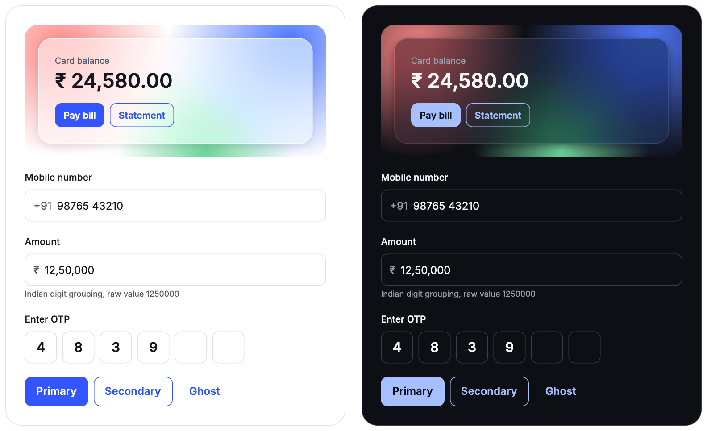
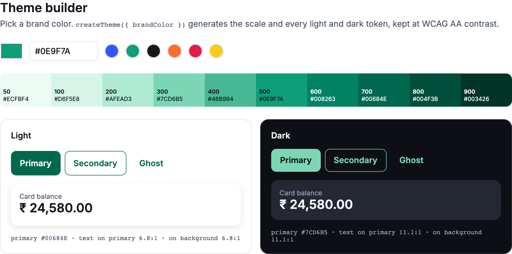
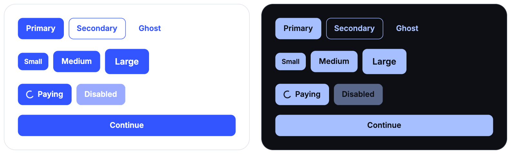
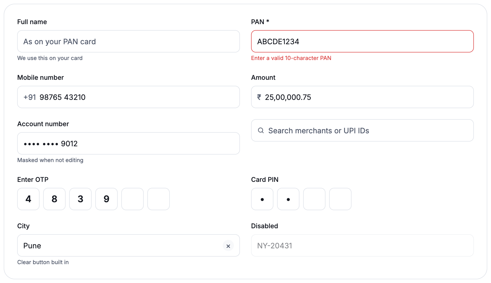
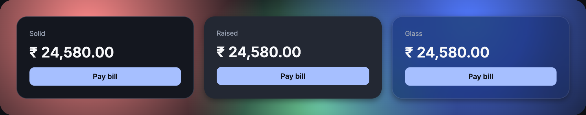
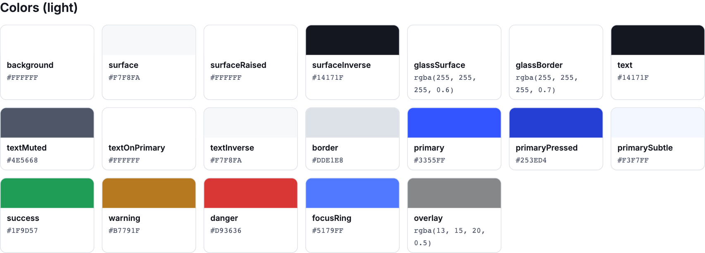
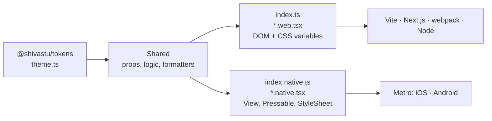

<div align="center">

# Tandem UI

**One design system for React and React Native.**<br />
The same component API and design tokens, with native rendering on each platform.


</div>



## Why Tandem UI

- **One API, two platforms.** `import { Button } from '@shivastu/ui'` renders a real `<button>` with CSS on the web and `Pressable` with `StyleSheet` on iOS and Android. No `react-native-web`, no bundler config.
- **Every design value in one file.** Colors, type, spacing, radius, shadows, motion, glass and component sizes live in [`theme.ts`](packages/tokens/src/theme.ts). Change it and web and native update together.
- **Your brand in one line.** `createTheme({ brandColor })` generates a full color scale and both light and dark tokens, kept at WCAG AA contrast. Tests check this for 12 very different brand colors.
- **Light, dark and glass.** Every component supports both color schemes, and surfaces and inputs have a frosted glass variant.
- **Built for fintech forms.** Phone, amount (Indian digit grouping), bank account (masked) and OTP / PIN fields that keep the caret in place while they format.
- **Accessible by default.** Labelled inputs, linked error messages, visible focus rings, and support for reduced motion and reduced transparency.

## Contents

- [Quick start](#quick-start)
- [Theme builder](#theme-builder)
- [Components](#components): [Buttons](#buttons) · [Inputs](#inputs) · [Surface and glass](#surface-and-glass)
- [Design tokens](#design-tokens)
- [How it works](#how-it-works)
- [Accessibility](#accessibility)
- [Development](#development)
- [Roadmap](#roadmap)

## Quick start

```sh
npm install @shivastu/ui
```

> The packages are not on npm yet. Until the first release, clone this repo and run `npm install && npm run build`.

**Web** (Vite, Next.js, any React 19 app). Load the Inter font, then wrap your app:

```tsx
import { Button, ThemeProvider } from '@shivastu/ui';

export function App() {
  return (
    <ThemeProvider colorScheme="light">
      <Button onPress={() => alert('Paid')}>Pay now</Button>
    </ThemeProvider>
  );
}
```

There are no CSS files to import: `ThemeProvider` adds the styles once, works with server rendering, and the web components are marked `'use client'` for the Next.js App Router.

**React Native** (Expo or bare). Load the Inter weights with `expo-font`, then pass their names so text uses them (without them the system font is used):

```tsx
import { BlurView } from 'expo-blur';
import { ThemeProvider, foundations } from '@shivastu/ui';

<ThemeProvider colorScheme={scheme} fonts={foundations.typography.fontFamily.native} blurView={BlurView}>
  <App />
</ThemeProvider>;
```

`blurView` is optional. It powers glass surfaces; without it they fall back to a solid surface, so Tandem UI never forces a native module on your app.

## Theme builder

Give one brand color and `createTheme` builds the rest: a 10-step scale generated in OKLCH (so the steps look even), plus the primary tokens for light and dark. Each step is picked to pass WCAG AA, and your exact color is used wherever it is readable.



```tsx
import { ThemeProvider, createTheme } from '@shivastu/ui';

const theme = createTheme({
  brandColor: '#0E9F7A',
  colors: { light: { success: '#16803C' } }, // any semantic color, per scheme
  foundations: {
    radius: { md: 12 },
    typography: { fontFamily: { web: 'Manrope, sans-serif' } },
  },
  components: { button: { sizes: { md: { height: 48 } } } },
});

<ThemeProvider theme={theme} colorScheme="dark">
  <App />
</ThemeProvider>;
```

- Every option is optional: anything you leave out keeps the default.
- Overriding `primary` on its own recomputes `textOnPrimary`, so text stays readable.
- A nested `ThemeProvider` keeps its parent's theme, so `<ThemeProvider colorScheme="dark">` inside a branded section only switches the scheme.
- Several themes can share one page: each theme's CSS variables are scoped to its own provider.
- Try it live in Storybook: **Foundations → Theme builder**.

## Components

### Buttons



```tsx
<Button onPress={pay}>Pay now</Button>
<Button variant="secondary" size="lg">View statement</Button>
<Button loading>Paying</Button>
<Button fullWidth disabled={!valid}>Continue</Button>
```

A loading button keeps its color, shows a spinner and is announced as busy; only a disabled button fades.

<details>
<summary>Button props</summary>

| Prop | Type | Default |
| --- | --- | --- |
| `children` | `string` | |
| `onPress` | `() => void` | |
| `variant` | `'primary' \| 'secondary' \| 'ghost'` | `'primary'` |
| `size` | `'sm' \| 'md' \| 'lg'` | `'md'` |
| `loading` | `boolean`: spinner, busy state, blocks presses | |
| `disabled` | `boolean` | |
| `fullWidth` | `boolean` | |
| `accessibilityLabel` | `string` | the label |
| `testID` | `string`: `data-testid` on web, `testID` on native; the spinner gets `${testID}-spinner` | |

</details>

### Inputs

`TextField` is the base. Every other input is a `TextField` with a formatter, so they all share labels, helper and error text, prefixes, variants (`outline`, `filled`, `glass`), sizes and keyboard handling.



```tsx
<TextField label="Full name" helperText="As on your PAN card" />
<PhoneField label="Mobile number" value={mobile} onChangeText={setMobile} />   // shows 98765 43210, returns "9876543210"
<AmountField label="Amount" value={amount} onChangeText={setAmount} />        // shows ₹ 12,34,567.89, returns "1234567.89"
<AccountNumberField label="Account number" />                                 // •••• •••• 9012 when not editing
<SearchField label="Search transactions" placeholder="Search" />              // hidden label, search icon, clear button
<OtpField label="Enter OTP" onComplete={verify} />                            // paste and SMS autofill work
<OtpField label="Card PIN" length={4} masked />
```

<table>
<tr>
<td width="44%"></td>
<td>

**A real form.** The re-enter field blocks pasting (`allowPaste={false}`), shows a mismatch error, and the button stays disabled until everything is valid.

```tsx
<AccountNumberField
  label="Re-enter account number"
  value={confirm}
  onChangeText={setConfirm}
  allowPaste={false}
  maskWhenBlurred={false}
  error={mismatch ? "Account numbers don't match" : undefined}
/>
```

- `onChangeText` always receives the **raw** value, while the field shows the formatted one.
- On the web the caret stays where you are typing, even when spaces or commas move.
- Build your own formatted field with `format` and `parse`:<br />`<TextField format={(v) => groupDigits(v, [4, 4, 4])} parse={digitsOnly} />`

</td>
</tr>
</table>

The formatters and validators are exported too: `formatAmount`, `parseAmount`, `formatPhone`, `formatAccountNumber`, `maskAccountNumber`, `isValidIndianMobile`, `isValidAccountNumber`, `digitsOnly`, `groupDigits`.

<details>
<summary>TextField props</summary>

| Prop | Type | Default |
| --- | --- | --- |
| `label` | `string` (required) | |
| `hideLabel` | `boolean`: keeps it for screen readers | |
| `value` / `defaultValue` / `onChangeText` | raw value, controlled or not | |
| `helperText` / `error` | `string` | |
| `variant` | `'outline' \| 'filled' \| 'glass'` | `'outline'` |
| `size` | `'md' \| 'lg'` | `'md'` |
| `prefix` / `suffix` | text or any element | |
| `inputMode` | `'text' \| 'numeric' \| 'decimal' \| 'tel' \| 'email' \| 'search' \| 'url'` | `'text'` |
| `autoComplete` | `'one-time-code'`, `'tel'`, `'email'`, … | |
| `format` / `parse` | raw value ↔ what the field shows | |
| `maxLength`, `secureTextEntry`, `clearable`, `allowPaste`, `required`, `disabled`, `readOnly` | | |
| `testID` | on the input; the input box gets `${testID}-control` | |

</details>

### Surface and glass



```tsx
<Surface variant="glass" blur="lg" padding="xl" radius="xl">
  <Balance />
</Surface>
```

- **Web:** `backdrop-filter` with the theme's blur and saturation. Browsers without it, and users who turn on "reduce transparency", get a solid surface.
- **React Native:** uses the `blurView` you pass to `ThemeProvider` (for example `BlurView` from expo-blur), with a solid fallback.

<details>
<summary>Surface props</summary>

| Prop | Type | Default |
| --- | --- | --- |
| `variant` | `'solid' \| 'raised' \| 'glass'` | `'solid'` |
| `padding` | spacing token, `'xs'` … `'3xl'` | `'lg'` |
| `radius` | radius token, `'sm'` … `'full'` | `'lg'` |
| `blur` | glass only: `'sm' \| 'md' \| 'lg'` | `'md'` |
| `shadow` | `'none' \| 'sm' \| 'md' \| 'lg'` | `md` for raised and glass, none for solid |
| `testID` | `string` | |

</details>

## Design tokens

Every design value lives in one file, [`packages/tokens/src/theme.ts`](packages/tokens/src/theme.ts). Raw hex values exist only in its palette: semantic colors, glass, overlays and shadows are all built from palette tokens, and tests fail if a raw color appears anywhere else.



<table>
<tr>
<td></td>
<td></td>
</tr>
</table>

| Export | What it holds |
| --- | --- |
| `palette` | Raw scales: `brand` (Cobalt `#3355FF`), `slate`, `green`, `amber`, `red`. Components never use these directly. |
| `themes.light` / `themes.dark` | Semantic `colors` and `shadows` for each color scheme |
| `foundations` | `typography` (families, weights, sizes, line heights, letter spacing, `textStyles`), `space`, `radius`, `borderWidth`, `opacity`, `focusRing`, `motion`, `glass`, `zIndex`, `breakpoints` |
| `components` | Component decisions built from the above: button, field and OTP sizes |
| `createTheme(options)` | Your own theme: a brand color plus any overrides |
| `getTheme(scheme)` | The default theme resolved for `'light'` or `'dark'` |

Semantic colors are named by role and grouped by prefix, so autocomplete shows related ones together:

| Group | Tokens |
| --- | --- |
| Backgrounds | `background`, `surface`, `surfaceRaised`, `surfaceInverse`, `glassSurface`, `glassBorder` |
| Text | `text`, `textMuted`, `textOnPrimary`, `textInverse` |
| Brand | `primary`, `primaryPressed`, `primarySubtle` |
| Status | `success`, `warning`, `danger` |
| Other | `border`, `focusRing`, `overlay` |

In components, `useTheme()` returns the resolved theme on both platforms:

```tsx
const { colors, space, radius, shadows, typography } = useTheme();
```

On the web, every token is also a CSS variable inside `ThemeProvider`, so your own CSS can use them:

```css
.card {
  background: var(--ds-color-surface-raised);
  padding: var(--ds-space-lg);
  border-radius: var(--ds-radius-lg);
  box-shadow: var(--ds-shadow-md);
  transition: transform var(--ds-duration-fast) var(--ds-easing-standard);
}
```

## How it works



```
packages/ui/src/
├─ index.ts               web entry    → *.web.tsx
├─ index.native.ts        native entry → *.native.tsx
├─ TextField/
│  ├─ TextField.shared.ts  props, shared by both
│  ├─ TextField.web.tsx    <input> + CSS classes
│  ├─ TextField.css.ts     web styles, reading theme CSS variables
│  └─ TextField.native.tsx TextInput + StyleSheet
└─ inputs/fields.shared.tsx  Phone, Amount, AccountNumber, Search: written once,
                             given each platform's TextField
```

- `package.json` exports the native entry under the `react-native` condition, which Metro uses; every other bundler gets the web entry.
- Each entry imports its platform files explicitly, so every import in the build is fully specified ESM that loads in Metro, Vite, webpack and plain Node.
- On the web, `ThemeProvider` renders one deduplicated React 19 `<style>` for the components, and one per theme with that theme's CSS variables.

## Accessibility

- Text and key color pairs pass **WCAG AA** in both schemes, for the default theme and for every theme `createTheme` generates. This is checked in tests.
- Inputs use their label as the accessible name. Helper and error text are linked (`aria-describedby` on web, `accessibilityHint` on native), and on the web errors also set `aria-invalid`.
- Buttons announce busy and disabled states; keyboard focus shows a visible ring.
- Motion respects `prefers-reduced-motion`, and glass respects `prefers-reduced-transparency`.

## Development

```sh
npm install
npm run build        # tokens, then ui
npm test             # token contrast + web (Vitest) + native (Jest)
npm run typecheck
npm run storybook    # web docs on http://localhost:6007
npm run native       # Expo dev server; open it in Expo Go
```

| Folder | What it is |
| --- | --- |
| [`packages/tokens`](packages/tokens) | `@shivastu/tokens`: the theme file, color engine and contrast tests |
| [`packages/ui`](packages/ui) | `@shivastu/ui`: components, `ThemeProvider` and `createTheme` |
| [`apps/docs`](apps/docs) | Storybook for the web components, with a light/dark switch and the theme builder |
| [`apps/native-demo`](apps/native-demo) | Expo app using the same components on iOS and Android |

## Roadmap

- [x] One theme file, light and dark, `createTheme` with brand colors and overrides
- [x] Button, Surface (with glass)
- [x] TextField, PhoneField, AmountField, AccountNumberField, SearchField, OtpField
- [x] Storybook docs, theme builder and Expo demo
- [ ] Dialog (becomes a bottom sheet on phones), BottomSheet, Snackbar, Banner
- [ ] AppBar, NavigationBar (horizontal, vertical, drawer, rail), Timeline
- [ ] TapToCopy, SwipeButton, Confetti, FileUpload, DatePicker, Avatar
- [ ] Hosted Storybook and automated npm releases

## License

[MIT](LICENSE) © Shivastu Shrivastava
