<div align="center">

# Moksha UI

**One design system for React and React Native.**<br />
The same component API and design tokens, with native rendering on each platform.


</div>

<p align="center">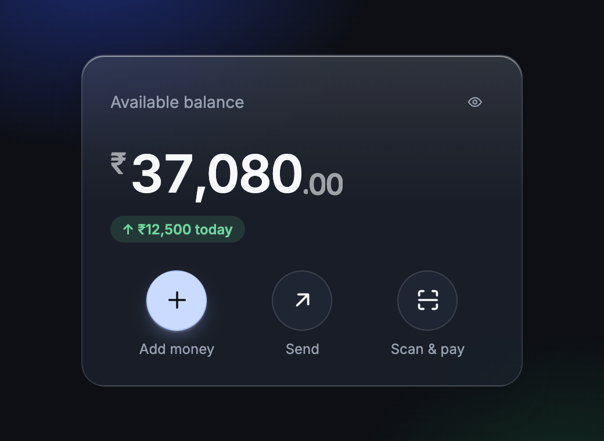</p>


## Why Moksha UI

- **One API, two platforms.** `import { Button } from '@moksha-ui/core'` renders a real `<button>` with CSS on the web and `Pressable` with `StyleSheet` on iOS and Android. No `react-native-web`, no bundler config.
- **Every design value in one file.** Colors, type, spacing, radius, shadows, motion, glass and component sizes live in [`theme.ts`](packages/tokens/src/theme.ts). Change it and web and native update together.
- **Your brand in one line.** `createTheme({ brandColor })` generates a full color scale and both light and dark tokens, kept at WCAG AA contrast. Tests check this for 12 very different brand colors.
- **Premium by default.** Motion runs on real spring physics that feel the same on web and native, surfaces have depth, hairline edges and frosted glass, and showpieces like a 3D bank card and a rolling balance come built in.
- **Light, dark and glass.** Every component supports both color schemes, and surfaces and inputs have a frosted glass variant.
- **Built for fintech forms.** Phone, amount (Indian digit grouping), bank account (masked) and OTP / PIN fields that keep the caret in place while they format.
- **Accessible by default.** Labelled inputs, linked error messages, visible focus rings, and support for reduced motion and reduced transparency. Colored text, badges and tags are adjusted automatically until they pass WCAG AA.

## Contents

- [Quick start](#quick-start)
- [Theme builder](#theme-builder)
- [Components](#components): [Buttons](#buttons) · [Inputs](#inputs) · [AutoForm](#autoform) · [Surface and glass](#surface-and-glass) · [Overlays](#overlays) · [Bank card](#bank-card) · [Rolling amount](#rolling-amount) · [Primitives](#primitives) · [Lists and tabs](#lists-and-tabs) · [Data display](#data-display) · [Flows](#flows) · [Entry](#entry) · [Navigation](#navigation) · [Money](#money) · [Floating](#floating) · [App shell](#app-shell) · [Pickers](#pickers) · [Motion](#motion)
- [Design tokens](#design-tokens)
- [How it works](#how-it-works)
- [Accessibility](#accessibility)
- [Development](#development)
- [Roadmap](#roadmap)

## Quick start

```sh
npm install @moksha-ui/core
```

> The packages are not on npm yet. Until the first release, clone this repo and run `npm install && npm run build`.

**Web** (Vite, Next.js, any React 19 app). Load the Inter font, then wrap your app:

```tsx
import { Button, ThemeProvider } from '@moksha-ui/core';

export function App() {
  return (
    <ThemeProvider colorScheme="light">
      <Button onPress={() => alert('Paid')}>Pay now</Button>
    </ThemeProvider>
  );
}
```

There are no CSS files to import: `ThemeProvider` adds the styles once, works with server rendering, and the web components are marked `'use client'` for the Next.js App Router.

**React Native** (Expo or bare). Load the Inter weights with `expo-font`, then pass their names so text uses them (without them the system font is used):

```tsx
import { BlurView } from 'expo-blur';
import { ThemeProvider, foundations } from '@moksha-ui/core';

<ThemeProvider colorScheme={scheme} fonts={foundations.typography.fontFamily.native} blurView={BlurView}>
  <App />
</ThemeProvider>;
```

`blurView` is optional. It powers glass surfaces; without it they fall back to a solid surface, so Moksha UI never forces a native module on your app.

## Theme builder

Give one brand color and `createTheme` builds the rest: a 10-step scale generated in OKLCH (so the steps look even), plus the primary tokens for light and dark. Each step is picked to pass WCAG AA, and your exact color is used wherever it is readable.


```tsx
import { ThemeProvider, createTheme } from '@moksha-ui/core';

const theme = createTheme({
  brandColor: '#0E9F7A',
  colors: { light: { success: '#16803C' } }, // any semantic color, per scheme
  foundations: {
    radius: { md: 12 },
    typography: { fontFamily: { web: 'Manrope, sans-serif' } },
  },
  components: { button: { sizes: { md: { height: 48 } } } },
});

<ThemeProvider theme={theme} colorScheme="dark">
  <App />
</ThemeProvider>;
```

- Every option is optional: anything you leave out keeps the default.
- Overriding `primary` on its own recomputes `textOnPrimary`, so text stays readable.
- A nested `ThemeProvider` keeps its parent's theme, so `<ThemeProvider colorScheme="dark">` inside a branded section only switches the scheme.
- Several themes can share one page: each theme's CSS variables are scoped to its own provider.
- Try it live in Storybook: **Foundations → Theme builder**.

## Components

### Buttons


```tsx
<Button onPress={pay}>Pay now</Button>
<Button variant="secondary" size="lg">View statement</Button>
<Button loading>Paying</Button>
<Button fullWidth disabled={!valid}>Continue</Button>
```

Buttons are pills. The primary one is lit from the top with a thin highlight and a soft glow in the brand color; secondary is a soft tint: the pale brand shade in light mode, and a quiet brand wash over the page in dark mode, like iOS tinted buttons. Its text stays at WCAG AA on the tint and on hover, for every brand color. Hover fades in a pressed layer instead of swapping the gradient, so nothing flickers, and every button shrinks slightly on press. A loading button keeps its color, shows a spinner, breathes a soft glow and is announced as busy; only a disabled button fades.

`IconButton` is the round version for a single icon, in `solid`, `soft`, `glass` and `ghost`. It needs an `accessibilityLabel`, since an icon alone has no name:

```tsx
<IconButton icon={<EyeIcon />} accessibilityLabel="Hide balance" pressed={hidden} variant="ghost" />
```

<details>
<summary>Button props</summary>

| Prop | Type | Default |
| --- | --- | --- |
| `children` | `string` | |
| `onPress` | `() => void` | |
| `variant` | `'primary' \| 'secondary' \| 'ghost'` | `'primary'` |
| `size` | `'sm' \| 'md' \| 'lg'` | `'md'` |
| `loading` | `boolean`: spinner, busy state, blocks presses | |
| `disabled` | `boolean` | |
| `fullWidth` | `boolean` | |
| `accessibilityLabel` | `string` | the label |
| `testID` | `string`: `data-testid` on web, `testID` on native; the spinner gets `${testID}-spinner` | |

</details>

### Inputs

`TextField` is the base. Every other input is a `TextField` with a formatter, so they all share labels, helper and error text, prefixes, variants (`outline`, `filled`, `glass`), sizes and keyboard handling.

Fields rest with a soft shadow and get a 4 px halo in the brand color on focus (red when there is an error), with a brand-colored caret. OTP cells show a blinking caret in the cell that takes the next digit.


```tsx
<TextField label="Full name" helperText="As on your PAN card" />
<PhoneField label="Mobile number" value={mobile} onChangeText={setMobile} />   // shows 98765 43210, returns "9876543210"
<AmountField label="Amount" value={amount} onChangeText={setAmount} />        // shows ₹ 12,34,567.89, returns "1234567.89"
<AccountNumberField label="Account number" />                                 // •••• •••• 9012 when not editing
<SearchField label="Search transactions" placeholder="Search" />              // hidden label, search icon, clear button
<OtpField label="Enter OTP" onComplete={verify} />                            // paste and SMS autofill work
<OtpField label="Card PIN" length={4} masked />
```

<table>
<tr>
<td width="44%">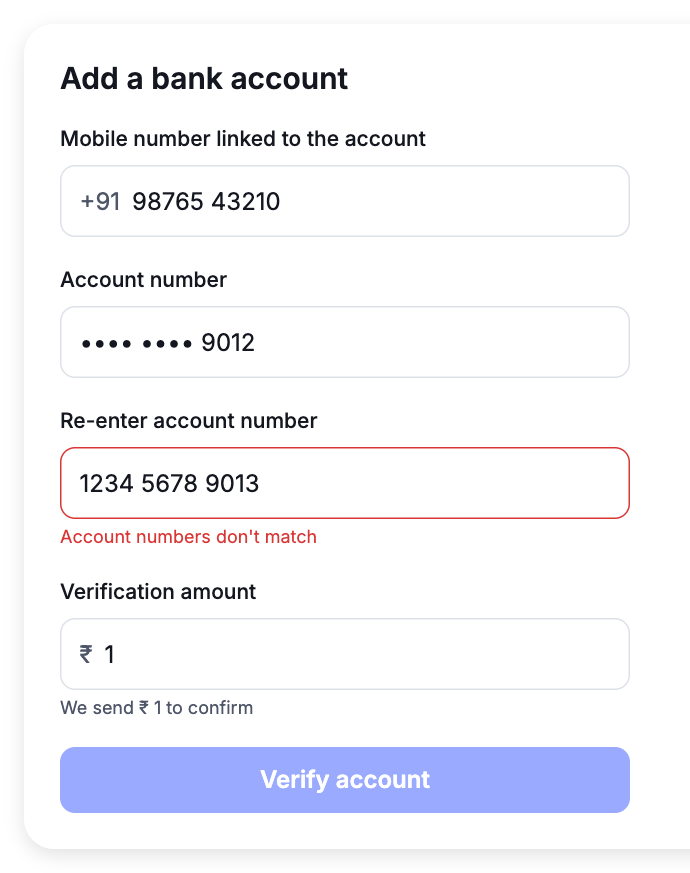</td>
<td>

**A real form.** The re-enter field blocks pasting (`allowPaste={false}`), shows a mismatch error, and the button stays disabled until everything is valid.

```tsx
<AccountNumberField
  label="Re-enter account number"
  value={confirm}
  onChangeText={setConfirm}
  allowPaste={false}
  maskWhenBlurred={false}
  error={mismatch ? "Account numbers don't match" : undefined}
/>
```

- `onChangeText` always receives the **raw** value, while the field shows the formatted one.
- On the web the caret stays where you are typing, even when spaces or commas move.
- Build your own formatted field with `format` and `parse`:<br />`<TextField format={(v) => groupDigits(v, [4, 4, 4])} parse={digitsOnly} />`

</td>
</tr>
</table>

The formatters and validators are exported too: `formatAmount`, `parseAmount`, `formatPhone`, `formatAccountNumber`, `maskAccountNumber`, `isValidIndianMobile`, `isValidAccountNumber`, `digitsOnly`, `groupDigits`.

<details>
<summary>TextField props</summary>

| Prop | Type | Default |
| --- | --- | --- |
| `label` | `string` (required) | |
| `hideLabel` | `boolean`: keeps it for screen readers | |
| `value` / `defaultValue` / `onChangeText` | raw value, controlled or not | |
| `helperText` / `error` | `string` | |
| `variant` | `'outline' \| 'filled' \| 'glass'` | `'outline'` |
| `size` | `'md' \| 'lg'` | `'md'` |
| `prefix` / `suffix` | text or any element | |
| `inputMode` | `'text' \| 'numeric' \| 'decimal' \| 'tel' \| 'email' \| 'search' \| 'url'` | `'text'` |
| `autoComplete` | `'one-time-code'`, `'tel'`, `'email'`, … | |
| `format` / `parse` | raw value ↔ what the field shows | |
| `maxLength`, `secureTextEntry`, `clearable`, `allowPaste`, `required`, `disabled`, `readOnly` | | |
| `testID` | on the input; the input box gets `${testID}-control` | |

</details>

### AutoForm

Pass a list of fields and get a complete form: the right input for each type, validation, error messages, focus handling and a submit button with a loading state. On web and React Native.

<table>
<tr>
<td width="44%">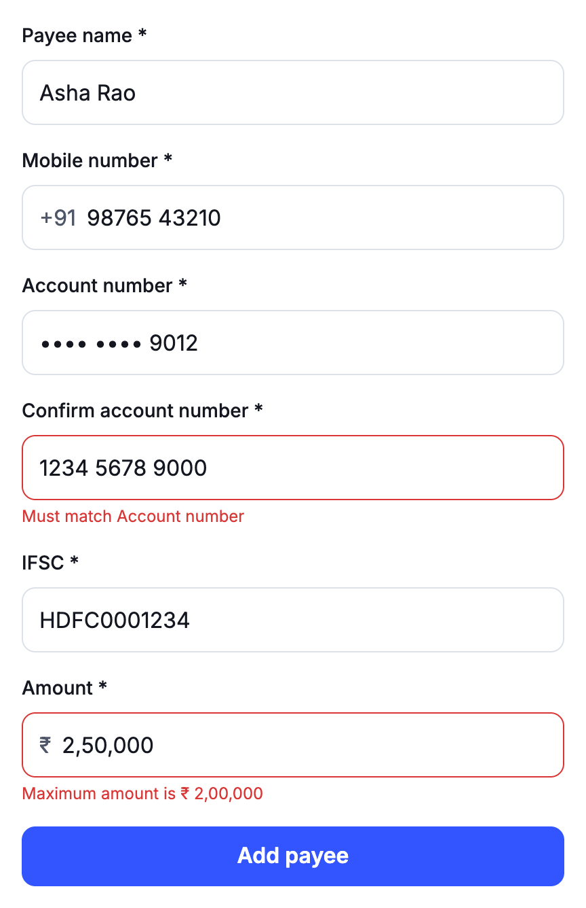</td>
<td>

```tsx
import { AutoForm, defineFields } from '@moksha-ui/core';

const fields = defineFields([
  { name: 'name', type: 'text', label: 'Payee name', required: true },
  { name: 'mobile', type: 'phone', label: 'Mobile number', required: true },
  { name: 'account', type: 'account', label: 'Account number', required: true },
  { name: 'confirm', type: 'account', label: 'Confirm account number',
    required: true, matches: 'account', allowPaste: false },
  { name: 'amount', type: 'amount', label: 'Amount',
    required: true, min: 1, max: 200000 },
]);

<AutoForm
  fields={fields}
  submitLabel="Add payee"
  onSubmit={async (values) => {
    // values.mobile, values.amount… typed from the names
    const result = await api.addPayee(values);
    if (!result.ok) return { account: result.message };
  }}
/>
```

</td>
</tr>
</table>

- **Types:** `text`, `email`, `password`, `phone`, `amount`, `account`, `otp`. Every other prop of the matching component works too (`helperText`, `maskWhenBlurred`, `format`, `variant`…).
- **Built-in checks:** required, Indian mobile numbers, amount `min` and `max`, account numbers (9 to 18 digits), OTP length and email. `matches` compares two fields, and `validate(value, values)` adds your own rule.
- **Errors appear after a field loses focus or on submit**, never while someone is still typing, and they clear as soon as the value is fixed. Submitting with errors focuses the first one.
- **Server errors:** return `{ fieldName: message }` from `onSubmit` to show them on those fields.
- **Enter, or the keyboard's return key,** moves to the next field; on the last field it submits. A form cannot be submitted twice while `onSubmit` is running.
- The field list is plain data, so it can come from your server as JSON. `validateForm(fields, values)` runs the same checks anywhere, including on the server.
- Every field also takes a `ref` with `focus()`.

### Surface and glass


```tsx
<Surface variant="glass" blur="lg" padding="xl" radius="xl">
  <Balance />
</Surface>
```

- **Web:** `backdrop-filter` with the theme's blur and saturation. Browsers without it, and users who turn on "reduce transparency", get a solid surface.
- **React Native:** uses the `blurView` you pass to `ThemeProvider` (for example `BlurView` from expo-blur), with a solid fallback.

<details>
<summary>Surface props</summary>

| Prop | Type | Default |
| --- | --- | --- |
| `variant` | `'solid' \| 'raised' \| 'glass'` | `'solid'` |
| `padding` | spacing token, `'xs'` … `'3xl'` | `'lg'` |
| `radius` | radius token, `'sm'` … `'full'` | `'lg'` |
| `blur` | glass only: `'sm' \| 'md' \| 'lg'` | `'md'` |
| `shadow` | `'none' \| 'sm' \| 'md' \| 'lg'` | `md` for raised and glass, none for solid |
| `testID` | `string` | |

</details>

### Overlays

<table>
<tr>
<td width="36%">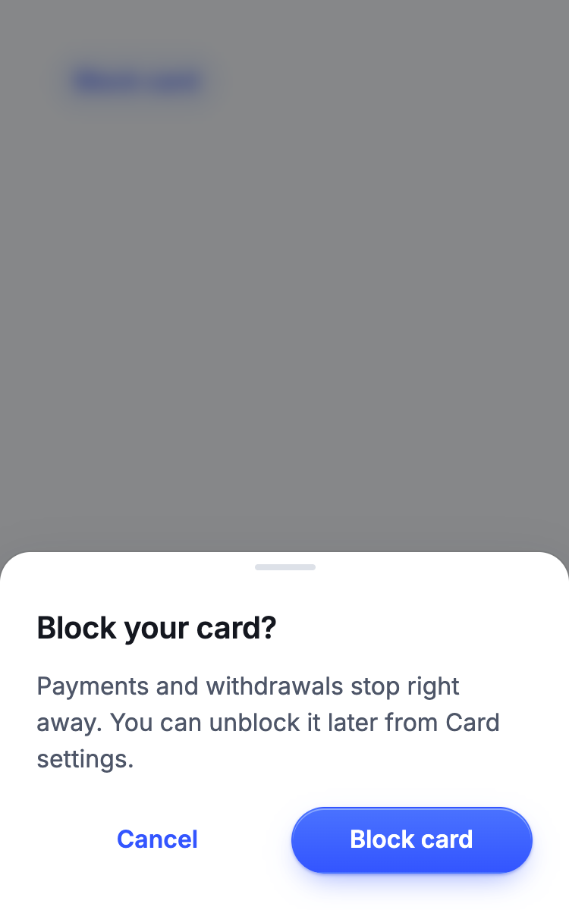</td>
<td></td>
</tr>
</table>

```tsx
<Dialog
  open={open}
  onClose={() => setOpen(false)}
  title="Block your card?"
  actions={
    <>
      <Button variant="ghost" onPress={() => setOpen(false)}>Cancel</Button>
      <Button onPress={blockCard}>Block card</Button>
    </>
  }
>
  Payments and withdrawals stop right away.
</Dialog>

<BottomSheet open={open} onClose={close} title="Pay from">…</BottomSheet>

<Banner tone="warning" title="KYC pending" action={{ label: 'Complete KYC', onPress: openKyc }}>
  Finish it by 30 November to keep using your card.
</Banner>

<PromoBanner
  eyebrow="Travel card"
  title="Pay abroad with zero forex markup"
  description="Use it in 180+ countries. Free ATM withdrawals."
  action={{ label: 'Get the card', onPress: openOffer }}
/>

// Once, near the root:
<SnackbarProvider><App /></SnackbarProvider>
// Anywhere below:
const snackbar = useSnackbar();
snackbar.show({ message: 'Payee deleted', action: { label: 'Undo', onPress: restore } });
```

- **Dialog** is centered on larger screens and becomes a bottom sheet on phones (`presentation="auto"`). On the web it uses the native `<dialog>` element, so focus stays inside, Escape closes it, the page behind can't be reached, and focus goes back to the button that opened it. On React Native it uses `Modal`, and Android back closes it. `dismissible={false}` keeps it open until an action is chosen.
- **BottomSheet** always slides up from the bottom, with a handle.
- **Snackbar** shows one message at a time and queues the rest. It hides after the theme's `snackbar.duration`, and on the web stays while the pointer is over it or it has keyboard focus. Screen readers announce every message.
- **Banner** has four tones (info, success, warning, danger), each a soft tint of its color with a round icon. The action sits on the right, and moves under the text on narrow screens. Text passes WCAG AA on every tone, in every theme `createTheme` makes. Only `danger` interrupts a screen reader; the others wait their turn.
- **PromoBanner** is for offers on a home screen: the brand gradient, an eyebrow, a title, one call to action, and a glass card drawn in the corner (pass `art` to use your own). The same gradient is drawn on React Native.


### Bank card

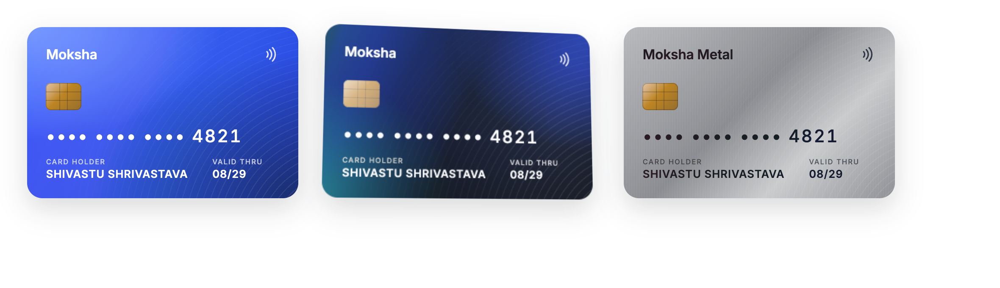

```tsx
<BankCard last4="4821" holder="Shivastu Shrivastava" expiry="08/29" finish="midnight" />
<BankCard {...card} flipped />  {/* the back: signature strip and CVV */}
<BankCard {...card} frozen />   {/* frosted, says "Frozen" */}
```

- Tilts toward the pointer (web) or finger (React Native) with a spring, and catches the light: a glare follows the pointer and a holographic band shifts across the card.
- Finishes: `brand` (follows your `createTheme` brand color), `midnight` and `metal`, with a gold chip, contactless mark and engraved pattern.
- `flipped` turns it over with a spring; `frozen` frosts it. With reduced motion it stays flat and flips at once.
- A card is a physical object, so it looks the same in light and dark mode. Screen readers hear one line: "Moksha card ending in 4821, Shivastu Shrivastava, expires 08/29".
- Bring your own network mark through `network`; real network logos are trademarks.

### Rolling amount


```tsx
<RollingAmount value={balance} size="xl" hidden={hideBalance} />
```

- Each digit is a reel that rolls to its new value with the `smooth` spring, lower places first, so a change ripples across the number like a mechanical counter. Digits roll up from 0 when the amount first appears.
- A digit keeps its reel as the number grows or shrinks: the units reel stays the units reel from 9,999 to 10,000.
- `hidden` blurs the amount on the web and shows bullets on React Native, for a "hide balance" toggle. Screen readers hear "Balance hidden" instead of the digits.
- Screen readers hear the amount once ("₹24,580.00"), never digit by digit. Indian grouping by default; `currency` and `decimals` change the rest.

### Primitives

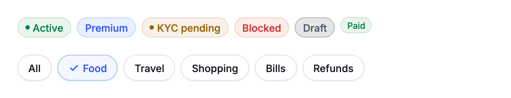

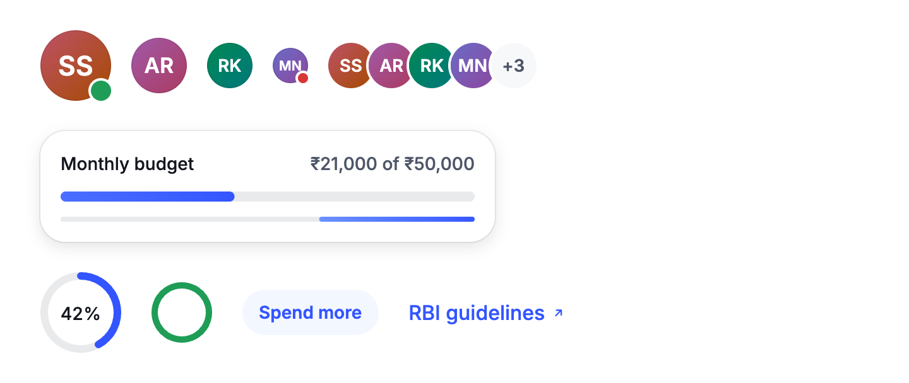

```tsx
<Text variant="heading" as="h2">Good evening, Shivastu</Text>
<Text variant="label" tone="success">Paid</Text>

<Stack direction="row" gap="md" align="center">
  <Avatar name="Shivastu Shrivastava" status="online" />
  <Tag tone="warning" dot>KYC pending</Tag>
  <Badge count={3} label="3 unread notifications" />
</Stack>

<Chip label="Food" selected={food} onSelectedChange={setFood} />
<ProgressBar value={42} label="Monthly budget used" />
<ProgressRing value={72} label="Budget used">72%</ProgressRing>
<Skeleton lines={2} />
```

- **Text** uses the theme's type styles; tones are adjusted to pass AA, so green and amber text stay readable. **Stack** lays children out with theme spacing; **Divider** can carry a label like "or continue with".
- **Badge** pops each time its count changes and has a hairline and a glossy top edge. **Tag** is a bordered status pill; **Chip** is a bordered filter that springs a check mark in when selected.
- **Avatar** shows a photo, or initials on a gradient picked from the name, so the same person always gets the same colors. **AvatarGroup** overlaps them with clean rings and reads the names once.
- **ProgressBar** springs its gradient fill to the value. When the amount of work is unknown, the whole fill breathes like every other loader; with reduced motion it holds dimmed, so it never looks finished. **ProgressRing** is a circular gauge, drawn without SVG on React Native.
- **Spinner** and **Skeleton** cover loading, and both breathe: the skeleton fades in and out, and the spinner's arc grows and shrinks as it turns (see Motion). With reduced motion the skeleton holds still. **Link** fades its underline in on hover and marks external links for screen readers.

### Lists and tabs

<table>
<tr>
<td>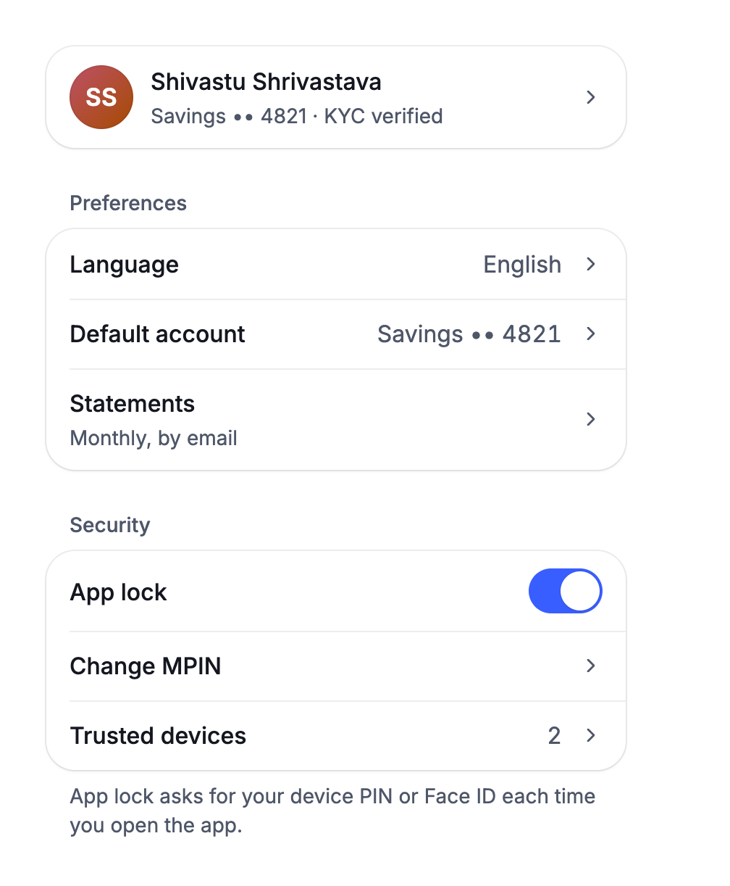</td>
<td>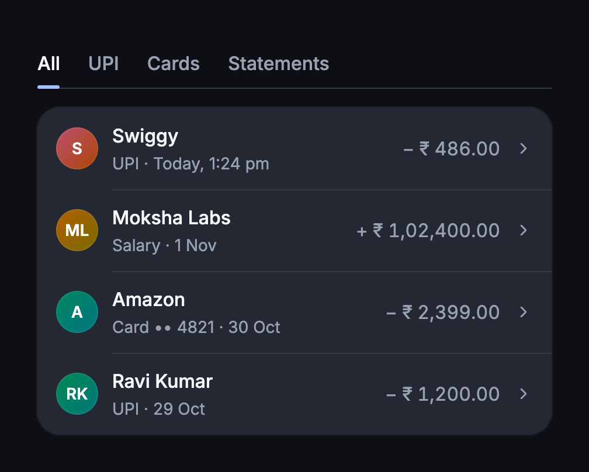</td>
</tr>
<tr>
<td colspan="2">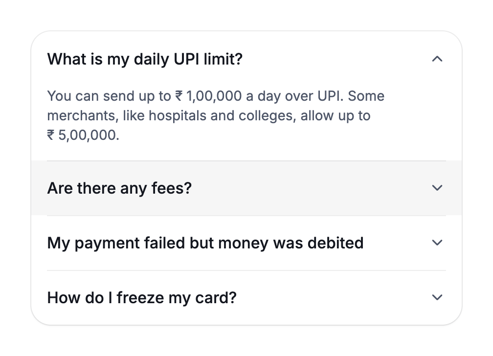</td>
</tr>
</table>

```tsx
<ListGroup title="Security" footer="App lock asks for your device PIN each time you open the app.">
  <ListItem title="App lock" trailing={<Switch accessibilityLabel="App lock" defaultChecked />} />
  <ListItem title="Language" trailing="English" onPress={openLanguage} />
</ListGroup>

<Tabs
  accessibilityLabel="Account activity"
  items={[
    { value: 'all', label: 'All', content: <Feed /> },
    { value: 'upi', label: 'UPI', content: <Feed via="upi" /> },
  ]}
/>

<Accordion items={faq} defaultValue={['limit']} />
```

- **ListItem** is a title with optional description, something before it (an avatar or logo) and a value or control after it. Give it `onPress` and the whole row becomes one button with a chevron that nudges on hover, named by its title and value ("Language, English").
- **ListGroup** puts rows on one raised card. Each divider sits under the title, not the full width, whatever the row starts with, and the group is a real list for screen readers.
- **Tabs** have an underline that slides and resizes to the selected tab on the same spring on web and native. Arrow keys, Home and End move between tabs, and the underline is kept at 3:1 contrast for every brand color.
- **Accordion** opens to the content's real height on a spring (no fixed max-height), one section at a time or several with `multiple`. Closed sections are out of the tab order and hidden from screen readers.

### Data display

<table>
<tr>
<td>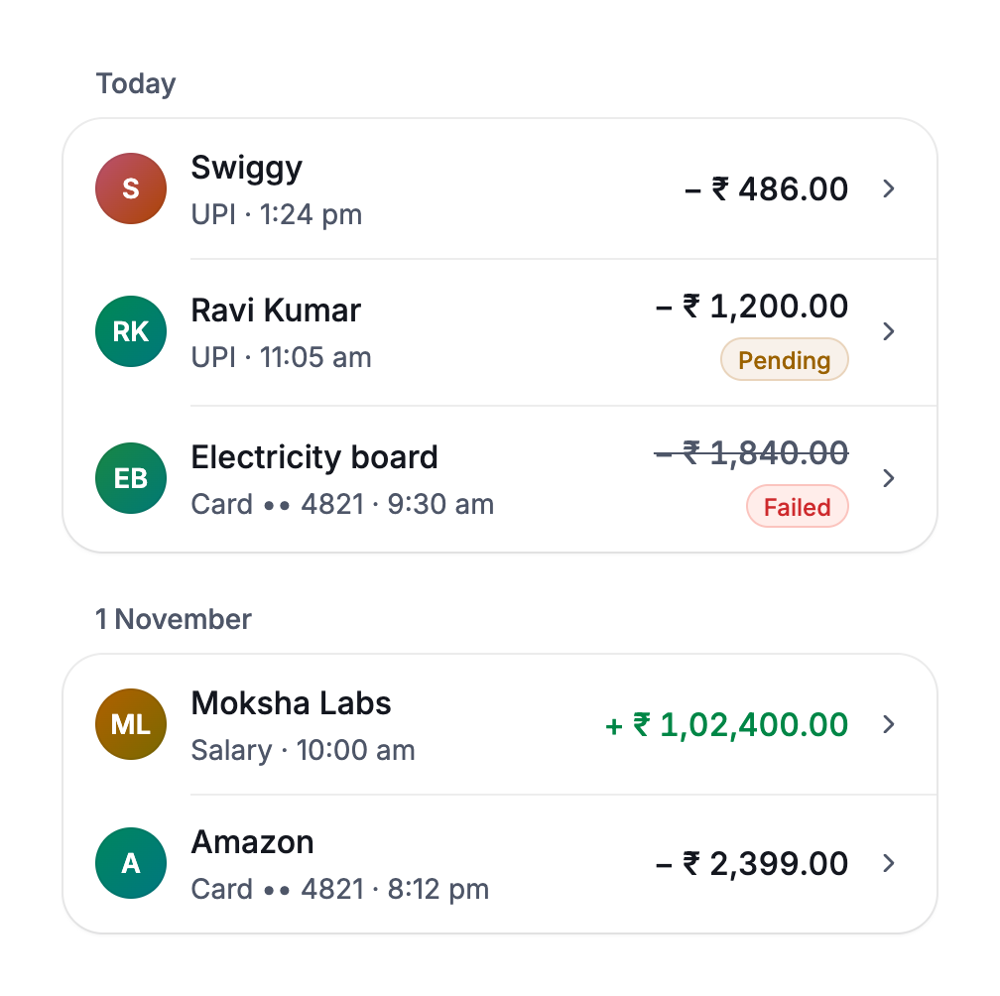</td>
<td>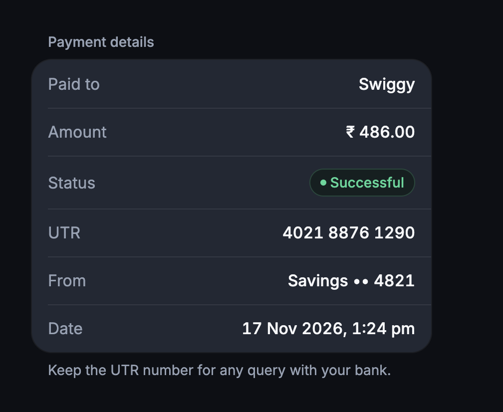</td>
</tr>
<tr>
<td>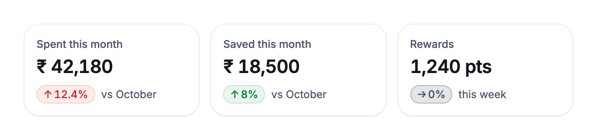</td>
<td>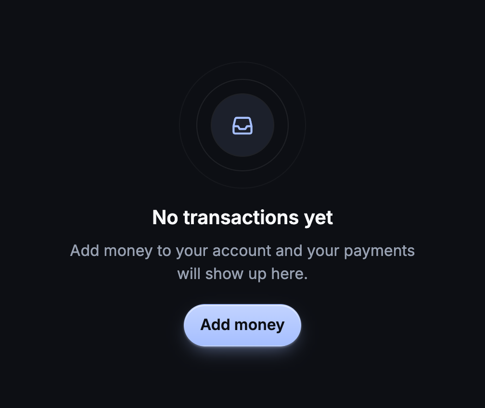</td>
</tr>
</table>

```tsx
<ListGroup title="Today">
  <TransactionRow name="Swiggy" amount={486} direction="debit" method="UPI" time="1:24 pm" onPress={openPayment} />
  <TransactionRow name="Moksha Labs" amount={102400} direction="credit" method="Salary" time="10:00 am" />
</ListGroup>

<DetailRow label="UTR" value="4021 8876 1290" />
<StatCard label="Spent this month" value="₹ 42,180" change="12.4%" trend="up" upIsGood={false} caption="vs October" />
<EmptyState icon={<InboxIcon />} title="No transactions yet" action={{ label: 'Add money', onPress: addMoney }} />
```

- **TransactionRow** formats the amount itself: Indian grouping, a real minus sign, and spaces that never break "₹" from the number. Money in is green, kept at AA on both the page and the card; money out stays in the text color, because red debits read like errors. Pending and failed payments get a tag, and failed amounts are struck through. Screen readers hear one sentence: "Paid ₹486.00 to Swiggy, 1:24 pm".
- **DetailRow** is a label and value for receipts and account details. Long values like reference numbers wrap instead of overflowing, and in a ListGroup each divider starts under the label.
- **StatCard** shows a figure and its change. A long figure shrinks to fit a narrow card (never below 18px) instead of spilling out. Set `upIsGood={false}` for spending and a rise turns red. The arrow is drawn, and the direction ("Up 12.4%") is what screen readers hear.
- **EmptyState** puts an icon in a soft brand-colored circle with rings that fade outward, then a title, a hint and one next step.

### Flows

<table>
<tr>
<td>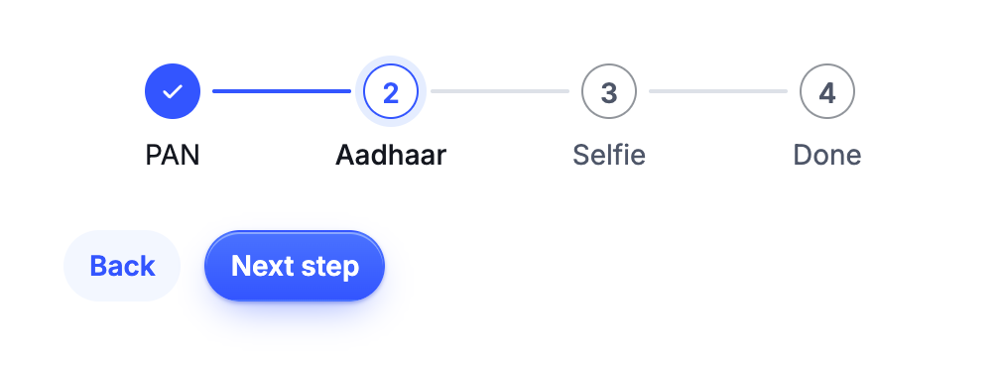</td>
<td>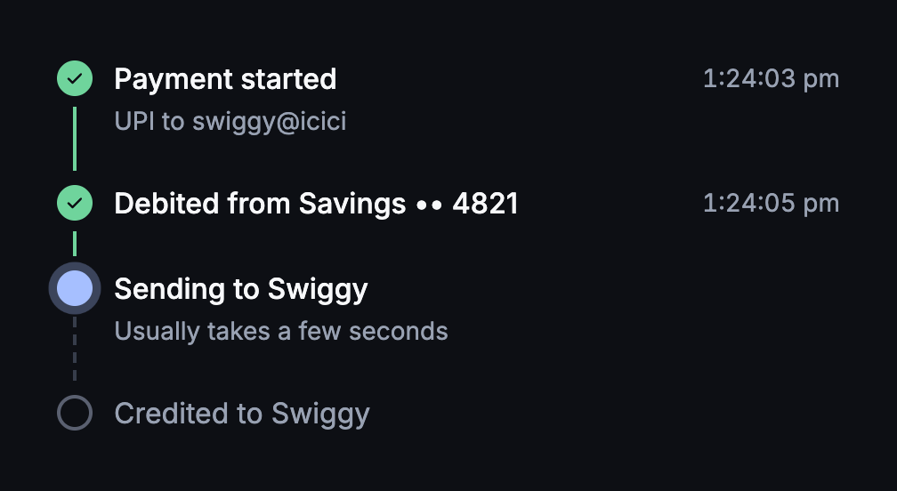</td>
</tr>
<tr>
<td>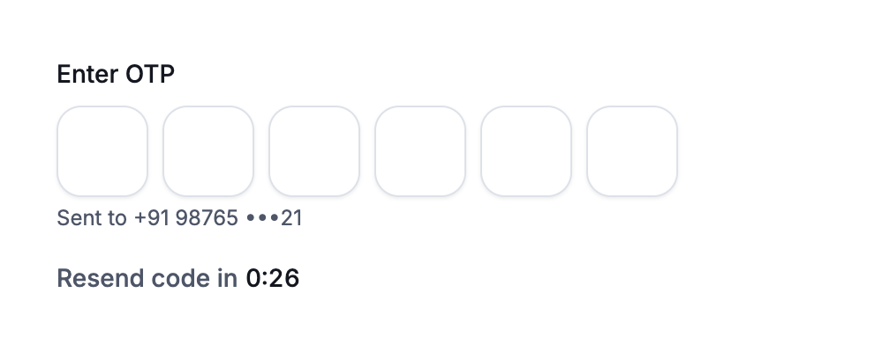</td>
<td>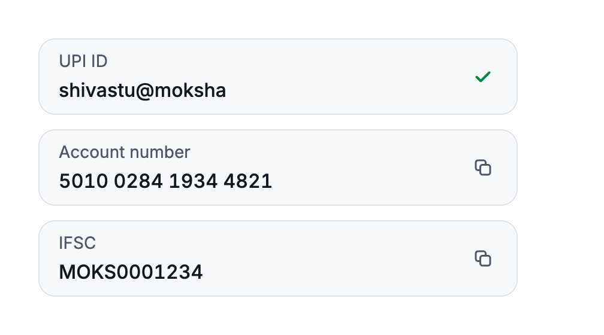</td>
</tr>
</table>

```tsx
<StepIndicator steps={['PAN', 'Aadhaar', 'Selfie', 'Done']} current={1} accessibilityLabel="KYC progress" />

<Timeline
  items={[
    { title: 'Debited from Savings •• 4821', time: '1:24:05 pm', status: 'complete' },
    { title: 'Sending to Swiggy', status: 'current' },
    { title: 'Credited to Swiggy', status: 'upcoming' },
  ]}
/>

<ResendTimer seconds={30} onResend={sendOtp} />
<CopyField label="UPI ID" value="shivastu@moksha" />
```

- **StepIndicator** fills the line into each step on a spring once you reach it. Screen readers hear "Done: PAN" and the current step on the web, and one "Step 2 of 4: Aadhaar" on native.
- **Timeline** follows a payment step by step: a check when done, a pulsing dot while in progress, a cross if it failed, and a dashed line for what's still ahead. Every status is spoken, not just shown in color.
- **ResendTimer** counts down to a fixed end time and reads the clock on every tick, so it's still right after the phone sleeps or the browser throttles a background tab. It restarts only after `onResend` succeeds; if sending fails, the user can try again straight away. The countdown isn't announced every second.
- **CopyField** shows the check only after the copy actually succeeds, and announces "UPI ID copied" once. If the browser blocks the clipboard, it selects the value so Ctrl/Cmd+C still works. On React Native, pass your app's clipboard function (like expo-clipboard's `setStringAsync`) as `onCopy`; without it, the value can still be long-pressed and copied.

### Entry

<table>
<tr>
<td>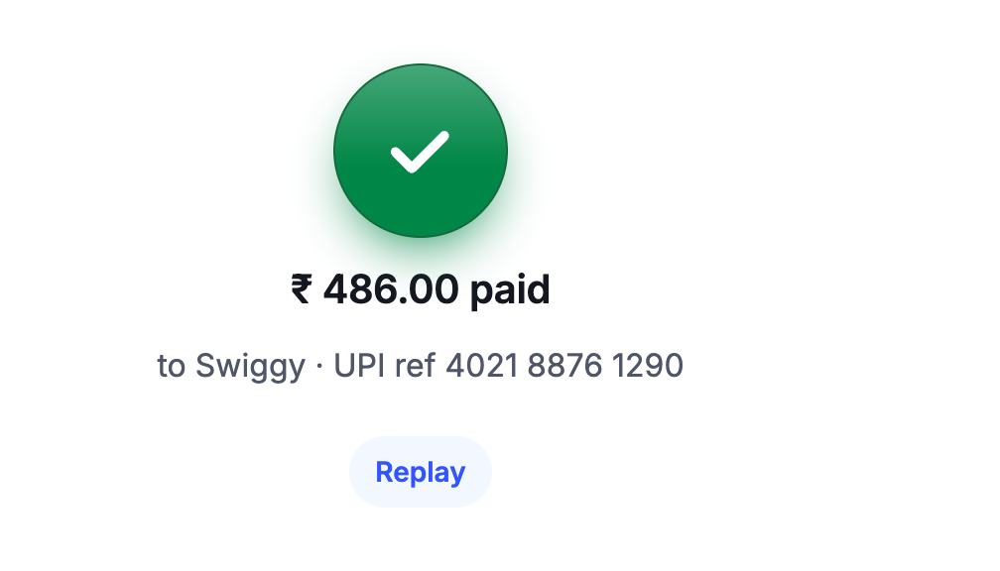</td>
<td>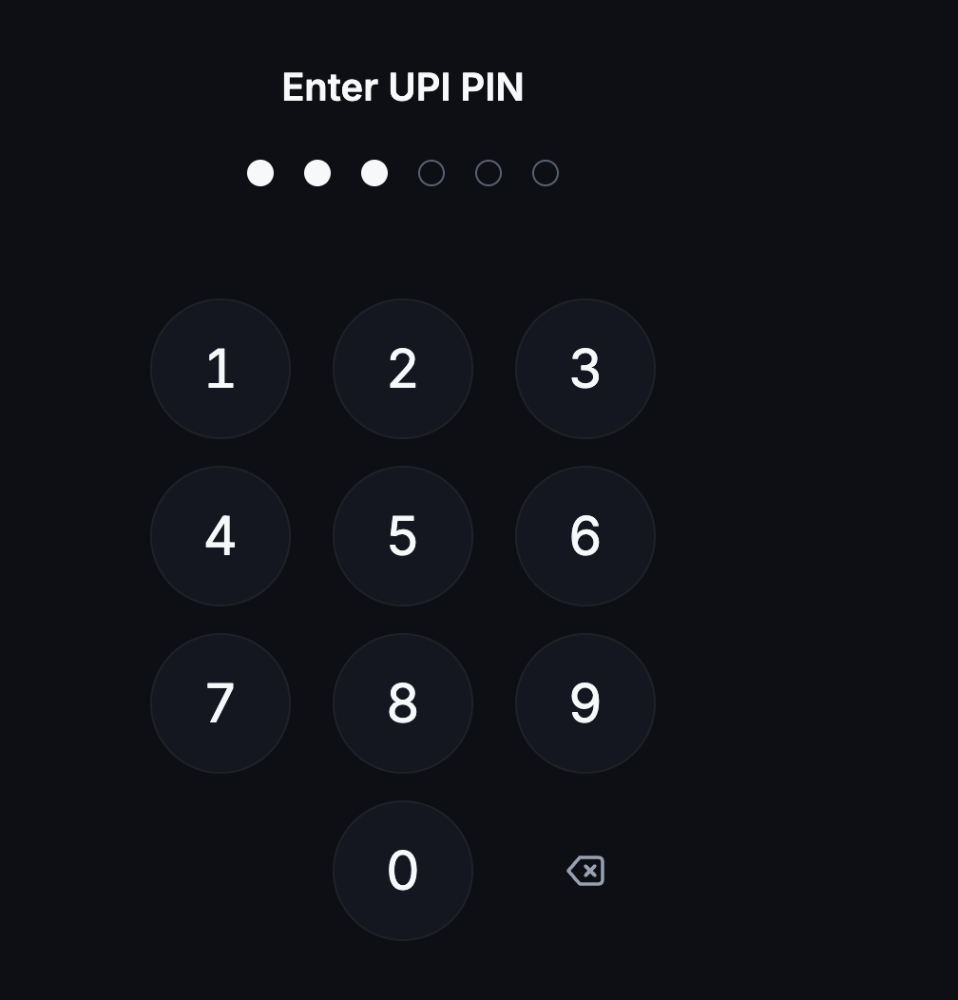</td>
</tr>
<tr>
<td>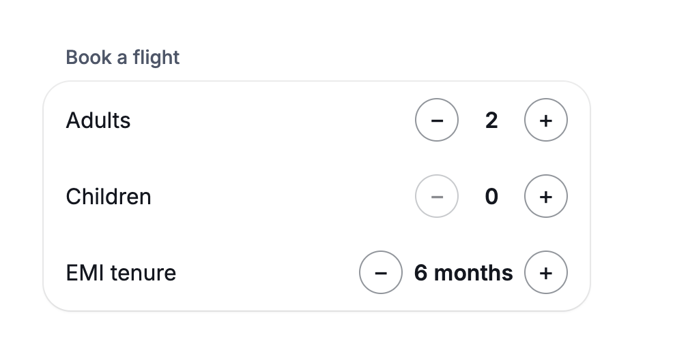</td>
<td>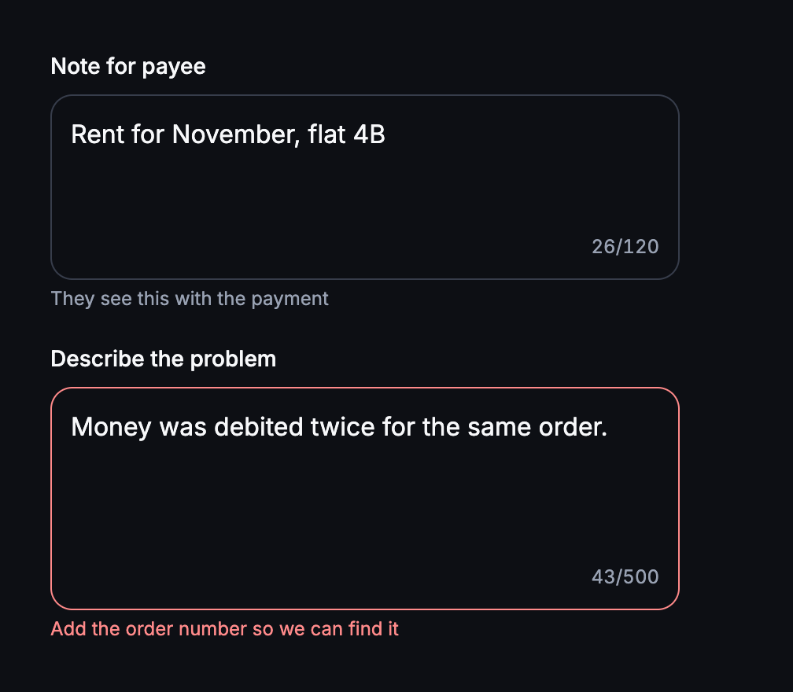</td>
</tr>
</table>

```tsx
<SuccessCheck size={88} accessibilityLabel="Payment successful" />

<PinPad label="Enter UPI PIN" length={6} value={pin} onValueChange={setPin} onComplete={verify} error={error} />

<NumberStepper label="EMI tenure" defaultValue={6} min={3} max={24} step={3} format={(months) => `${months} months`} />

<TextArea label="Note for payee" helperText="They see this with the payment" maxLength={120} />
```

- **SuccessCheck** plays once: the disc springs in (about 19% overshoot, then settles), the check draws itself from start to end, and a ring fades out. On native the check is drawn with two growing lines, so there's no SVG or Lottie dependency. With reduced motion it shows the finished mark straight away.
- **PinPad** fills a dot with a pop for each digit and shakes the dots on a wrong PIN. Screen readers hear "3 of 6 digits entered", never the digits themselves. On the web, typing digits and Backspace work too.
- **NumberStepper** rolls the new number in from the direction it moved. On the web it's a spinbutton (arrow keys, Home, End); on native screen-reader users swipe up and down to change it. The buttons disable at the limits.
- **TextArea** grows one line at a time up to `maxRows`, then scrolls. The counter sits in the corner and turns red at the limit, and screen readers hear it as "42 of 120 characters". It shares TextField's focus halo, error shake and label wiring.

### Navigation

<table>
<tr>
<td>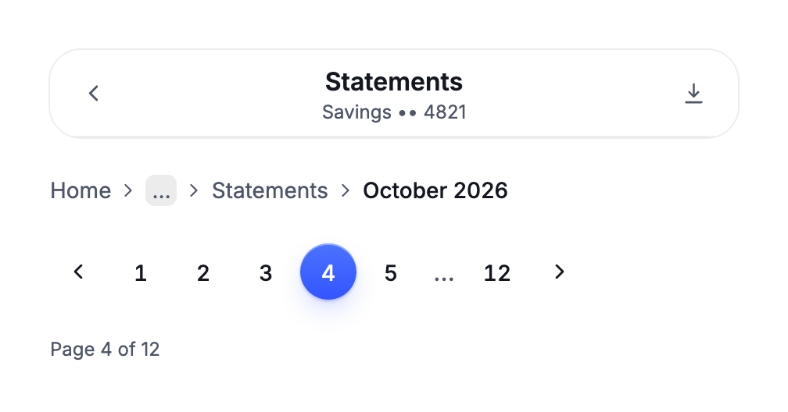</td>
<td>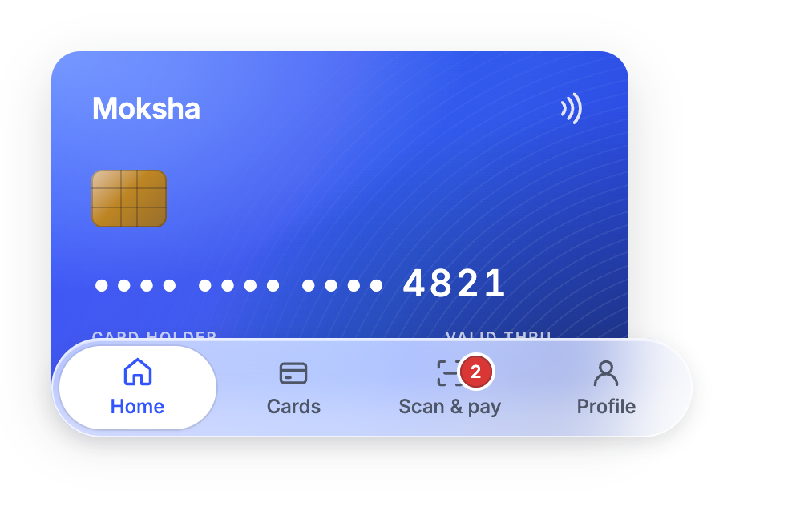</td>
</tr>
</table>

```tsx
<AppBar title="Statements" subtitle="Savings •• 4821" onBack={goBack} actions={<IconButton icon={<DownloadIcon />} accessibilityLabel="Download all" variant="ghost" />} />

<Breadcrumbs items={[{ label: 'Home', href: '/' }, { label: 'Accounts', href: '/accounts' }, { label: 'October 2026' }]} />

<Pagination page={page} onPageChange={setPage} pageCount={12} accessibilityLabel="Statement pages" />

<TabBar
  items={[
    { value: 'home', label: 'Home', icon: (color) => <HomeIcon color={color} /> },
    { value: 'pay', label: 'Scan & pay', icon: (color) => <ScanIcon color={color} />, badge: 2 },
  ]}
/>
```

- **AppBar** keeps the title centered whether or not there's a back button. On the web the title is a real heading.
- **Breadcrumbs** fold a long middle behind "…". Pressing it shows the full path and moves focus to the first item it revealed, so keyboard users don't lose their place. The last item is marked as the current page.
- **Pagination** always shows 7 slots once there are more than 7 pages, so the buttons don't shift as you page. On a screen too narrow for that, it drops to 5 (`1 … 5 … 12`) instead of running off the edge. The current page has the primary Button's top-lit fill and glow, and pops in.
- **TabBar** floats on frosted glass (the same blur as Surface). A raised pill springs to the active section and its icon lifts slightly. Icons are drawn in whatever color you're given, because React Native has no `currentColor`. A badge reads as part of the tab's name: "Scan & pay, 2 new".

### Money

<table>
<tr>
<td>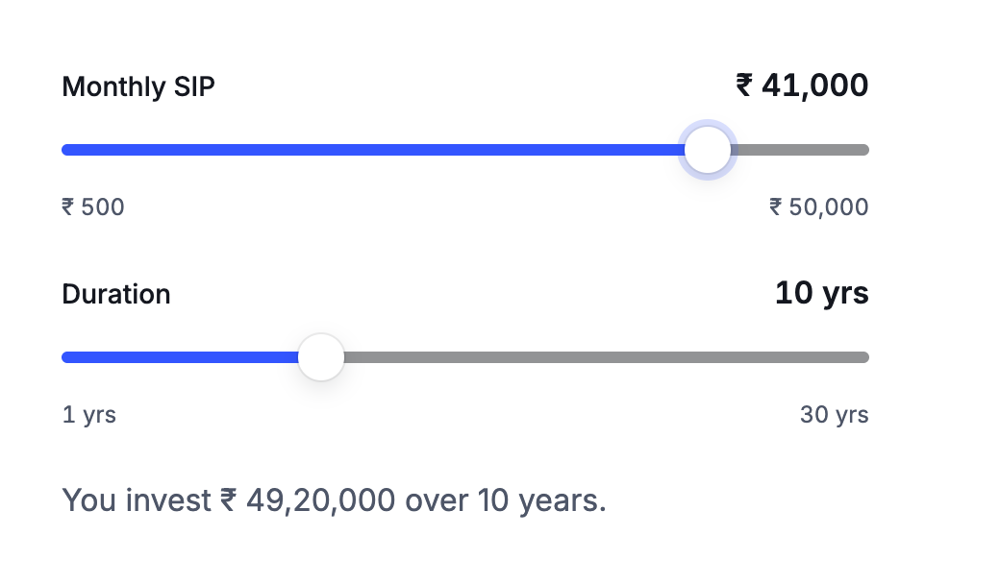</td>
<td>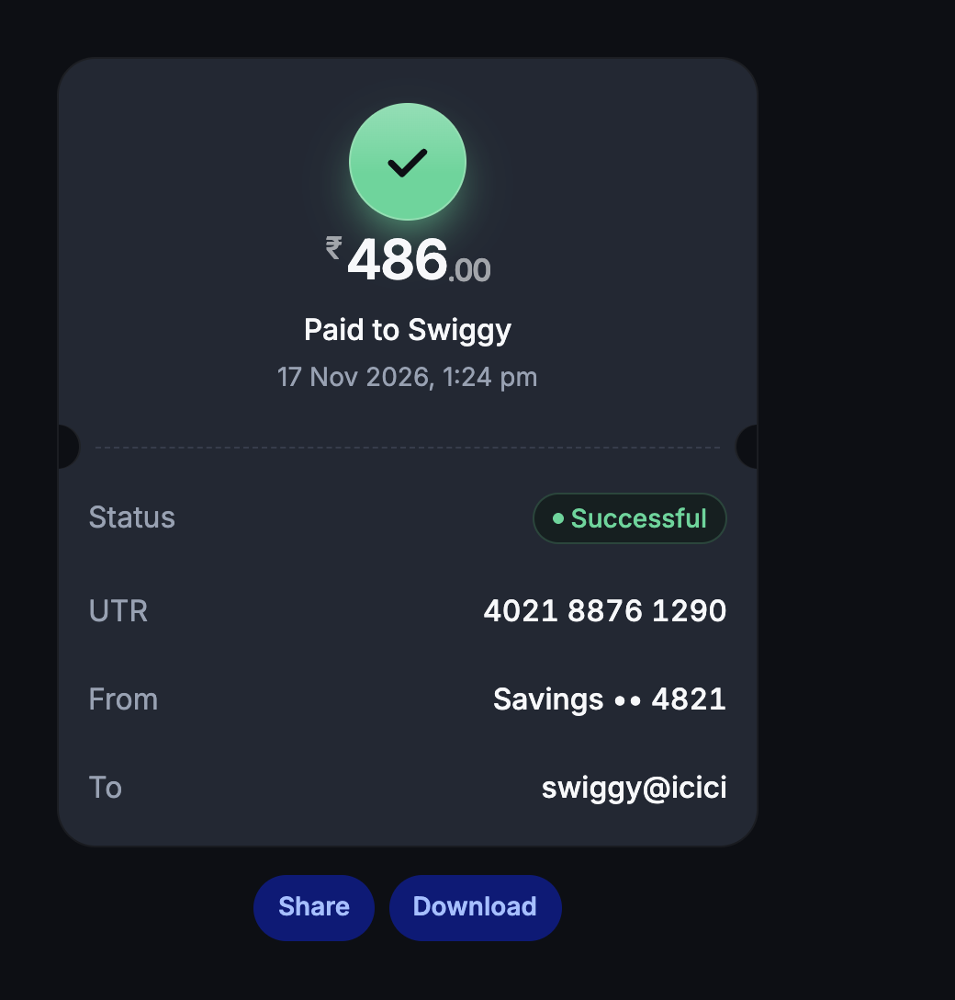</td>
</tr>
<tr>
<td>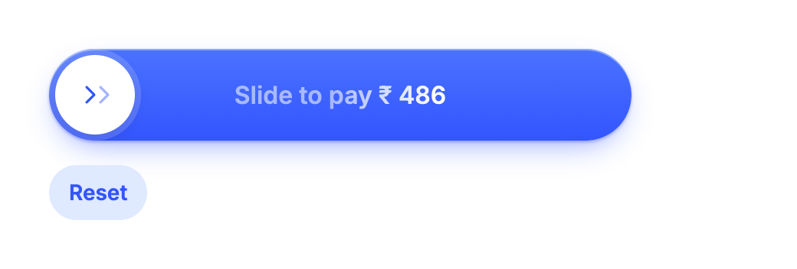</td>
<td>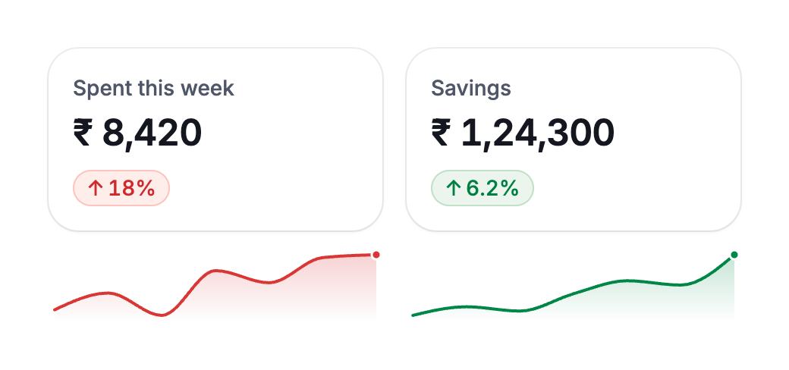</td>
</tr>
</table>

```tsx
<Slider label="Monthly SIP" min={500} max={50000} step={500} value={sip} onValueChange={setSip} format={(n) => `₹ ${n.toLocaleString('en-IN')}`} />

<SlideToConfirm label="Slide to pay ₹ 486" pendingLabel="Paying" doneLabel="Paid ₹ 486" onConfirm={pay} />

<Sparkline data={week} upIsGood={false} accessibilityLabel="Spending this week, ₹920 rising to ₹1,510" />

<Receipt status="success" amount={486} title="Paid to Swiggy" subtitle="17 Nov 2026, 1:24 pm" details={[{ label: 'UTR', value: '4021 8876 1290' }]} />
```

- **Slider** is the browser's own range input on the web, restyled, so keyboard, touch, forms and screen readers all work out of the box. The thumb grows while held. On native it's built with touch handling (no extra module) and screen-reader users swipe up and down to change it.
- **SlideToConfirm** pays only when the knob is let go past 90% of the track, so a slip doesn't send money. Let go earlier and it springs back. If `onConfirm` fails it returns to the start and never shows "Done". On the web, keyboard users press Enter or Space and desktop screen readers activate it; a plain mouse click does nothing. Native screen-reader users double-tap. *Known gap:* with VoiceOver or TalkBack on mobile web, a double-tap only nudges the knob.
- **Sparkline** uses the same smoothing as d3's `curveMonotoneX`, so the curve never shows a high or low that isn't in the data (tests check every segment). It draws itself in, with a soft fill underneath and a dot on the latest value. On native the same curve is drawn from short line pieces, with no SVG dependency.
- **Receipt** looks like a torn ticket: a status that's always spoken in words, the amount rolling in, a dashed tear line with notches, and the details below. The notches are filled with the page background (`--ds-receipt-notch` on the web), so place it on the page background.

### Floating

<table>
<tr>
<td>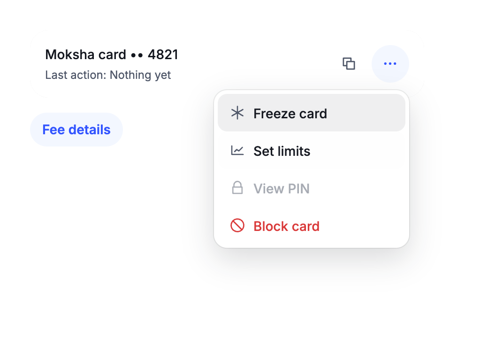</td>
<td>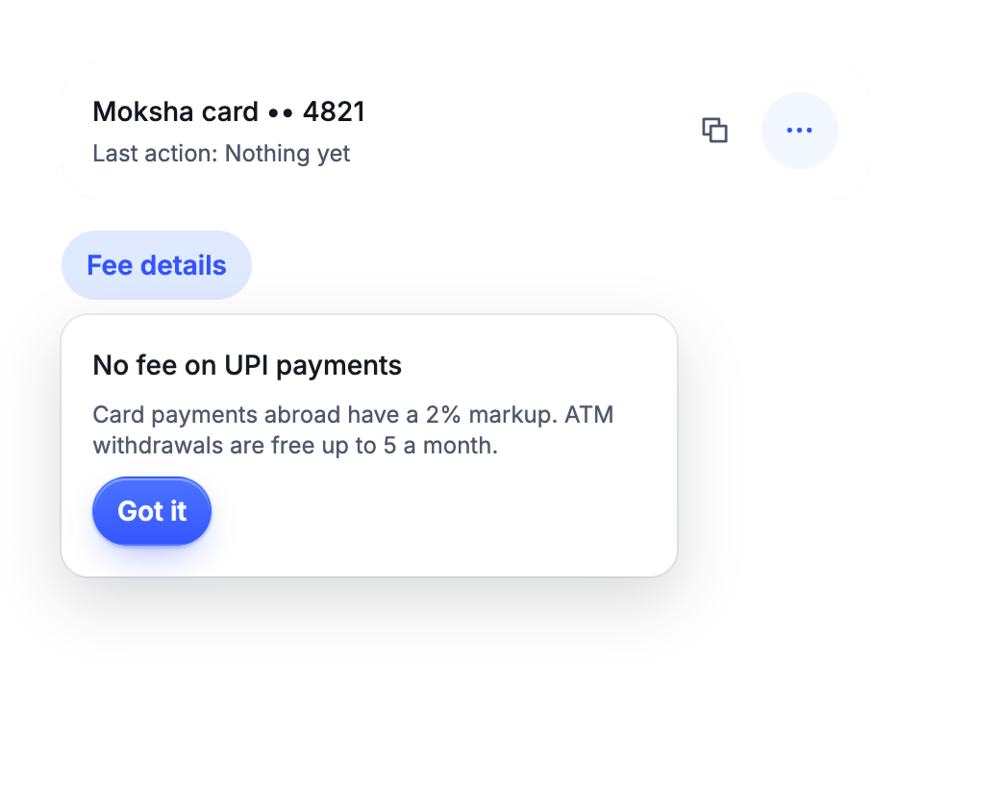</td>
</tr>
<tr>
<td>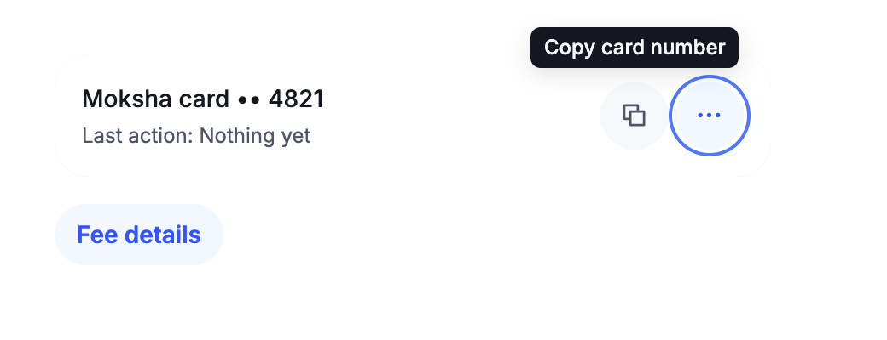</td>
<td>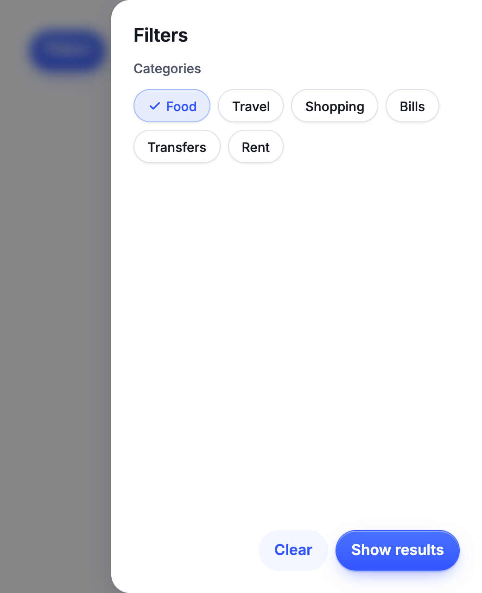</td>
</tr>
</table>

```tsx
const anchor = useRef(null);

<span ref={anchor}>
  <IconButton icon={<MoreIcon />} accessibilityLabel="Card actions" onPress={() => setOpen(!open)} />
</span>
<Menu anchor={anchor} open={open} onClose={() => setOpen(false)} accessibilityLabel="Card actions" items={[{ label: 'Freeze card', onSelect: freeze }, { label: 'Block card', tone: 'danger', onSelect: block }]} />

<Popover anchor={feeAnchor} open={fees} onClose={closeFees} accessibilityLabel="Fee details">…</Popover>

<Tooltip label="Copy card number">
  <IconButton icon={<CopyIcon />} accessibilityLabel="Copy card number" onPress={copy} />
</Tooltip>

<Drawer open={filters} onClose={closeFilters} title="Filters" side="right" actions={<Button onPress={apply}>Show results</Button>}>…</Drawer>
```

- **Popover** and **Menu** open in the browser's top layer, so a parent with `overflow: hidden` can't clip them, and they follow the trigger as you scroll. One placement rule (tested on its own) is shared with native: they open on the preferred side if there's room, otherwise flip, and always stay on screen. Pressing the trigger toggles them instead of closing and reopening. On native they open in a transparent Modal measured against the trigger.
- **Menu** follows the WAI-ARIA menu pattern: focus starts on the first item, the arrow keys, Home and End move and skip disabled items, Escape closes and returns focus to the trigger, and choosing an item does the same. Destructive items are shown in red.
- **Tooltip** appears after a short hover, or straight away on keyboard focus. It's visual only: screen readers skip it, so its text must also be the control's name. On native a long press shows it, and the button's normal press still works.
- **Drawer** is a side panel built on the same `<dialog>` as Dialog, so it gets the same focus trap, Escape to close, blurred backdrop and focus return. It springs in from the `side` you choose. On iOS, VoiceOver's escape gesture closes popovers, menus and drawers.

### App shell

<table>
<tr>
<td>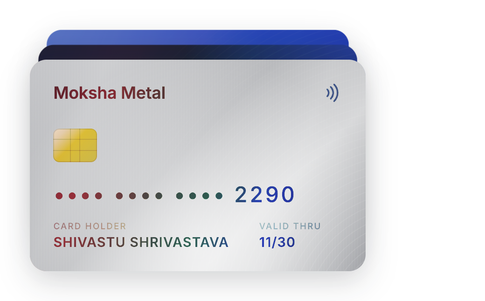</td>
<td>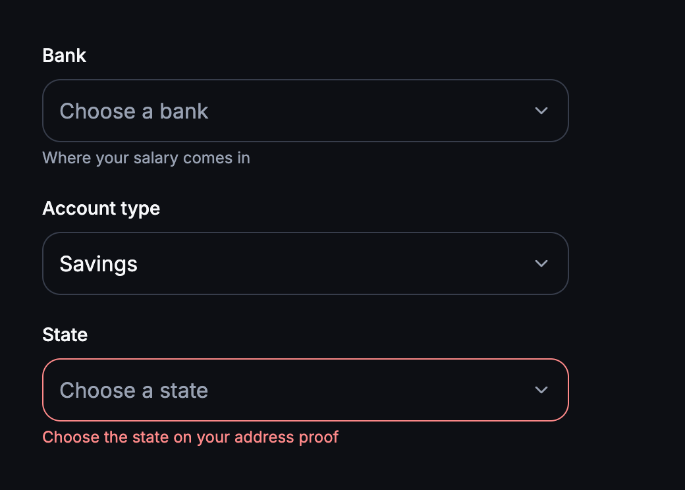</td>
</tr>
<tr>
<td colspan="2">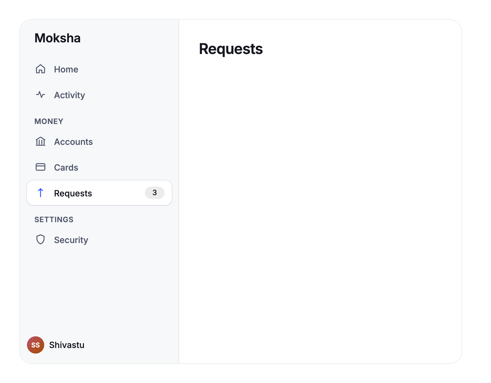</td>
</tr>
</table>

```tsx
<Select label="Bank" placeholder="Choose a bank" options={banks} value={bank} onValueChange={setBank} />

<CardStack cards={[{ key: 'metal', label: 'Moksha Metal •• 2290', card: <BankCard finish="metal" … /> }, …]} />

<Sidebar value={page} onValueChange={setPage} sections={[{ title: 'Money', items: [{ value: 'requests', label: 'Requests', count: 3, icon: (color) => <ArrowIcon color={color} /> }] }]} />
```

- **Select** is the browser's own `<select>` styled like a field, so phones show their native picker and forms and the keyboard just work. A placeholder can't be chosen again. On native it opens a bottom sheet of options, using Dialog's sheet.
- **CardStack** stacks cards like a wallet: each card behind is lifted 24px, shrunk 5% and darkened 12%, inside its own rounded corners. Tapping a card's visible edge springs it to the front. Each visible edge is a full 24px tap target (WCAG 2.5.8). Cards behind are buttons ("Show Moksha Metal •• 2290") for keyboard and screen-reader users, and the new front card is announced.
- **Sidebar** groups navigation under section titles, with a raised pill that springs to the current page like Tabs and TabBar. Counts are part of the name ("Requests, 3 new"), and icons are drawn in the color they're given, the same as in TabBar.

### Pickers

<table>
<tr>
<td>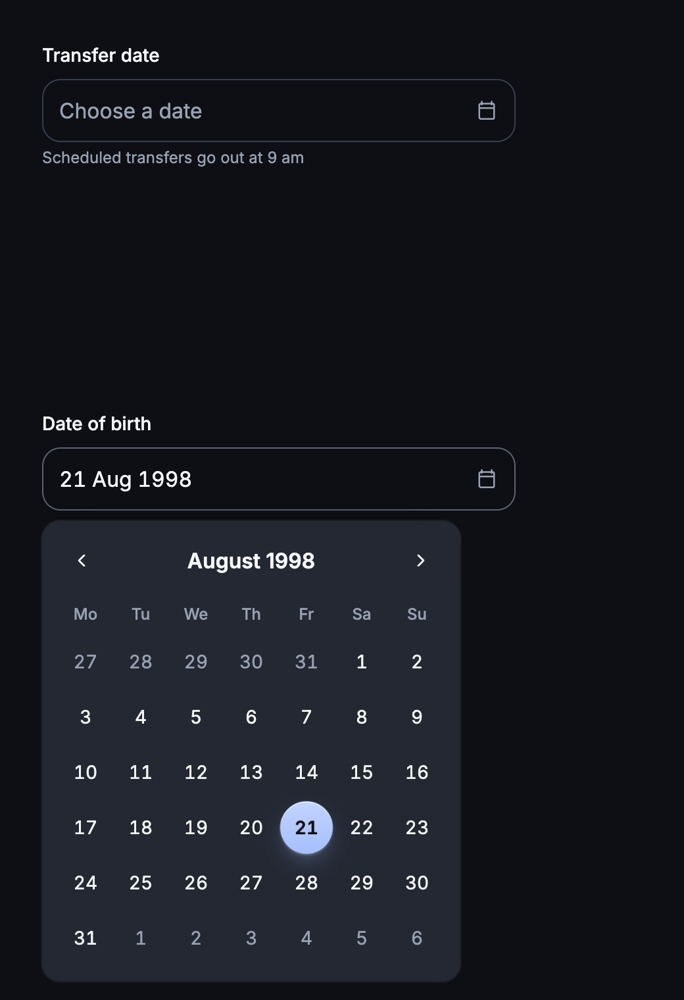</td>
<td>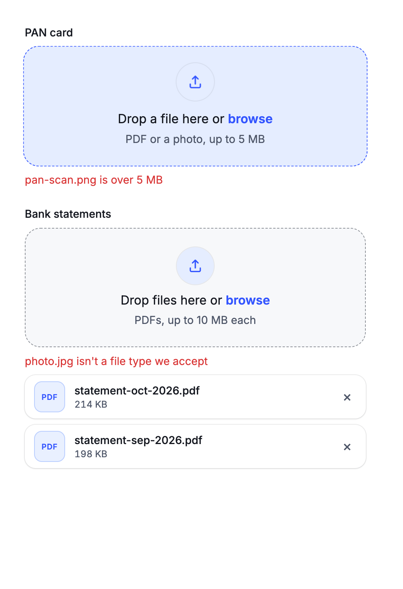</td>
</tr>
</table>

```tsx
<DatePicker label="Transfer date" min={today} max="2027-02-28" value={date} onValueChange={setDate} />

<FileUpload label="PAN card" accept=".pdf,image/*" maxSize={5 * 1024 * 1024} hint="PDF or a photo, up to 5 MB" onValueChange={setFiles} />
```

- **DatePicker** stores days as `'YYYY-MM-DD'` and does all date maths in UTC, so time zones and daylight saving can never move a day (a test steps through 400 days in a row). The calendar opens on the chosen day or today, and follows the WAI-ARIA date grid: arrow keys move by day or week, Page Up and Page Down by month, Home and End to the ends of the week. Days outside `min`/`max` are struck through and can't be picked, and each new month slides in from the side it came from. Weeks start on Sunday, as most Indian calendars do; set `weekStartsOn={1}` for Monday. On the web it opens in a Popover and on native in a bottom sheet.
- **FileUpload** checks every file against one set of rules (`accept` extensions, exact types or `image/*`, `maxSize`, duplicates) and gives a reason for each one it refuses. On the web, files can be dropped or picked with a real file input; after a file is removed, focus moves back to "browse". On native, pass your app's picker (like expo-document-picker) as `onPick`; without it the zone is disabled.

### Motion

Motion is built in. Every component already moves: buttons press down, fields shake when an error appears, OTP digits pop in. To animate your own content, use `Motion` and `Stagger`:

```tsx
import { Motion, Stagger } from '@moksha-ui/core';

<Motion preset="fadeUp">
  <BalanceCard />
</Motion>

<Stagger>
  {payments.map((payment) => (
    <PaymentRow key={payment.id} {...payment} />
  ))}
</Stagger>
```

- Presets: `fade`, `fadeUp`, `fadeDown`, `scaleIn`, `slideUp`. Durations, easings, distances and the stagger interval are theme tokens, so `createTheme` can change them.
- **Springs** (`snappy`, `smooth`, `bouncy`) are real physics: on the web they become CSS `linear()` easings (`var(--ds-spring-smooth)`), and on React Native the same stiffness and damping go to `Animated.spring`, so both platforms move the same way.
- **Web:** CSS keyframes, with no JavaScript animation loop. **React Native:** `Animated` on the native driver, using the same easing curves as the web.
- **One press feel.** Everything you can press uses the same wash of its own text color: `opacity.hover` (6%) on hover and `opacity.pressed` (12%) while held. Objects (buttons, chips, keys, calendar days, tabs) also shrink to 97% on the snappy spring; rows (list items, menu items, sidebar items) only highlight, as on iOS. Hover only applies where there's a real pointer, so a tap on a phone leaves nothing behind. On the web it's one `ds-press` class; on React Native, one `Press` component. A test fails if a component hardcodes its own hover or press strength.
- **Loading breathes.** Skeletons, the spinner's arc, a loading button's glow, a pending receipt, slide-to-pay while paying, and the timeline's in-progress dot all follow one rhythm, `motion.breathe`: a full breath every 2 seconds on a sine curve, fading to 45% at the out-breath. It animates only opacity and transform, so it stays smooth.
- With reduced motion turned on (`prefers-reduced-motion` on the web, Reduce Motion on iOS and Android), movement becomes a plain fade or is skipped, and loaders stop breathing.

<details>
<summary>Motion props</summary>

| Prop | Type | Default |
| --- | --- | --- |
| `preset` | `'fade' \| 'fadeUp' \| 'fadeDown' \| 'scaleIn' \| 'slideUp'` | `'fadeUp'` |
| `delay` | ms | `0` |
| `duration` | `'fast' \| 'normal' \| 'slow'` | `'normal'` |
| `easing` | easing token | `'enter'` |
| `interval` | `Stagger` only: ms between items | theme `motion.stagger` |
| `testID` | `string` | |

`useReducedMotion()` is exported too, for your own animations.

</details>

## Design tokens

Every design value lives in one file, [`packages/tokens/src/theme.ts`](packages/tokens/src/theme.ts). Raw hex values exist only in its palette: semantic colors, glass, overlays and shadows are all built from palette tokens, and tests fail if a raw color appears anywhere else.


<table>
<tr>
<td>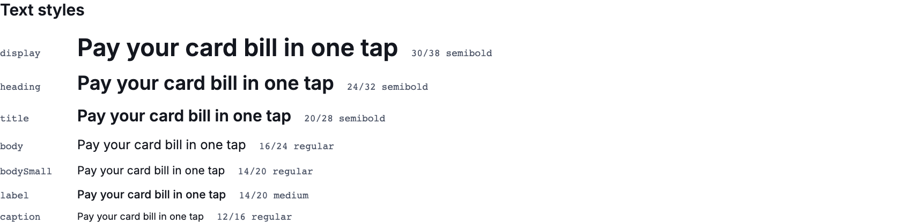</td>
<td>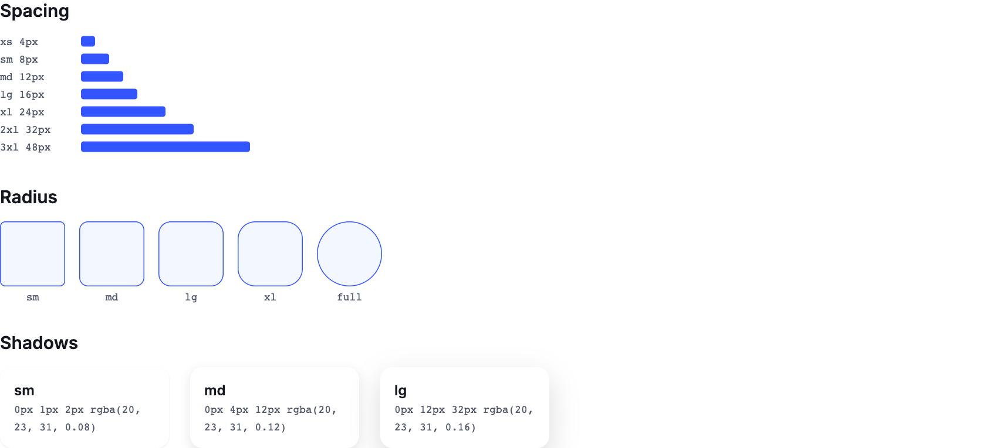</td>
</tr>
</table>

| Export | What it holds |
| --- | --- |
| `palette` | Raw scales: `brand` (Cobalt `#3355FF`), `slate`, `green`, `amber`, `red`. Components never use these directly. |
| `themes.light` / `themes.dark` | Semantic `colors` and `shadows` for each color scheme |
| `foundations` | `typography` (families, weights, sizes, line heights, letter spacing, `textStyles`), `space`, `radius`, `borderWidth`, `opacity`, `focusRing`, `motion`, `glass`, `zIndex`, `breakpoints` |
| `components` | Component decisions built from the above: button, field and OTP sizes |
| `createTheme(options)` | Your own theme: a brand color plus any overrides |
| `getTheme(scheme)` | The default theme resolved for `'light'` or `'dark'` |

Semantic colors are named by role and grouped by prefix, so autocomplete shows related ones together:

| Group | Tokens |
| --- | --- |
| Backgrounds | `background`, `surface`, `surfaceRaised`, `surfaceInverse`, `glassSurface`, `glassBorder` |
| Text | `text`, `textMuted`, `textOnPrimary`, `textInverse` |
| Brand | `primary`, `primaryPressed`, `primarySubtle` |
| Status | `success`, `warning`, `danger` |
| Other | `border`, `focusRing`, `overlay` |

In components, `useTheme()` returns the resolved theme on both platforms:

```tsx
const { colors, space, radius, shadows, typography } = useTheme();
```

On the web, every token is also a CSS variable inside `ThemeProvider`, so your own CSS can use them:

```css
.card {
  background: var(--ds-color-surface-raised);
  padding: var(--ds-space-lg);
  border-radius: var(--ds-radius-lg);
  box-shadow: var(--ds-shadow-md);
  transition: transform var(--ds-duration-fast) var(--ds-easing-standard);
}
```

## How it works


```
packages/ui/src/
├─ index.ts               web entry    → *.web.tsx
├─ index.native.ts        native entry → *.native.tsx
├─ TextField/
│  ├─ TextField.shared.ts  props, shared by both
│  ├─ TextField.web.tsx    <input> + CSS classes
│  ├─ TextField.css.ts     web styles, reading theme CSS variables
│  └─ TextField.native.tsx TextInput + StyleSheet
└─ inputs/fields.shared.tsx  Phone, Amount, AccountNumber, Search: written once,
                             given each platform's TextField
```

- `package.json` exports the native entry under the `react-native` condition, which Metro uses; every other bundler gets the web entry.
- Each entry imports its platform files explicitly, so every import in the build is fully specified ESM that loads in Metro, Vite, webpack and plain Node.
- On the web, `ThemeProvider` renders one deduplicated React 19 `<style>` for the components, and one per theme with that theme's CSS variables.

## Accessibility

- Text and key color pairs pass **WCAG AA** in both schemes, for the default theme and for every theme `createTheme` generates. This is checked in tests.
- Colors that would fail are fixed at the source: `ensureContrast` nudges a color's lightness, keeping its hue, until it passes. Colored text tones, badge fills, tag text and avatar gradients all go through it.
- Inputs use their label as the accessible name. Helper and error text are linked (`aria-describedby` on web, `accessibilityHint` on native), and on the web errors also set `aria-invalid`.
- Buttons announce busy and disabled states; keyboard focus shows a visible ring.
- Motion respects reduced motion on every platform (`prefers-reduced-motion` on the web, Reduce Motion on iOS and Android), and glass respects `prefers-reduced-transparency`.

## Development

```sh
npm install
npm run build        # tokens, then ui
npm test             # token contrast + web (Vitest) + native (Jest)
npm run typecheck
npm run storybook    # web docs on http://localhost:6007
npm run native       # Expo dev server; open it in Expo Go
```

| Folder | What it is |
| --- | --- |
| [`packages/tokens`](packages/tokens) | `@moksha-ui/tokens`: the theme file, color engine and contrast tests |
| [`packages/ui`](packages/ui) | `@moksha-ui/core`: components, `ThemeProvider` and `createTheme` |
| [`apps/docs`](apps/docs) | Storybook for the web components, with a light/dark switch and the theme builder |
| [`apps/native-demo`](apps/native-demo) | Expo app using the same components on iOS and Android |

## Roadmap

- [x] One theme file, light and dark, `createTheme` with brand colors and overrides
- [x] Button, Surface (with glass)
- [x] TextField, PhoneField, AmountField, AccountNumberField, SearchField, OtpField
- [x] Storybook docs, theme builder and Expo demo
- [x] Motion: `Motion`, `Stagger` and built-in component animations
- [x] AutoForm: build a whole form from a list of fields, with validation
- [x] Dialog (becomes a bottom sheet on phones), BottomSheet, Snackbar, Banner, PromoBanner
- [x] Spring motion tokens and the 3D BankCard
- [x] RollingAmount (balance with rolling digits)
- [ ] Blocks: slide to pay, payment success, phone + OTP login, transactions feed
- [ ] Showcase site with a live gallery, and one-command install (shadcn registry, llms.txt)
- [ ] Hosted Storybook and automated npm releases

### 50 components

All 50 are done. Every one ships for web and React Native, uses only theme tokens, and is tested on both platforms.

- **Primitives:** [x] Text · [x] Stack · [x] Divider · [x] Spinner · [x] Skeleton · [x] Badge · [x] Tag · [x] Chip · [x] Avatar · [x] AvatarGroup · [x] ProgressBar · [x] ProgressRing · [x] Link
- **Selection and input:** [x] Switch · [x] Checkbox · [x] RadioGroup · [x] SegmentedControl · [x] Slider · [x] NumberStepper · [x] Select · [x] DatePicker · [x] TextArea · [x] PinPad · [x] SlideToConfirm · [x] FileUpload · [x] CopyField
- **Navigation:** [x] Tabs · [x] AppBar · [x] TabBar · [x] Sidebar · [x] Breadcrumbs · [x] Pagination · [x] StepIndicator · [x] Drawer
- **Lists and display:** [x] ListItem · [x] ListGroup · [x] Accordion · [x] StatCard · [x] DetailRow · [x] Timeline · [x] EmptyState · [x] TransactionRow · [x] Receipt · [x] Sparkline · [x] CardStack
- **Feedback and overlays:** [x] Tooltip · [x] Popover · [x] Menu · [x] SuccessCheck · [x] ResendTimer

## License

[MIT](LICENSE) © Shivastu Shrivastava
