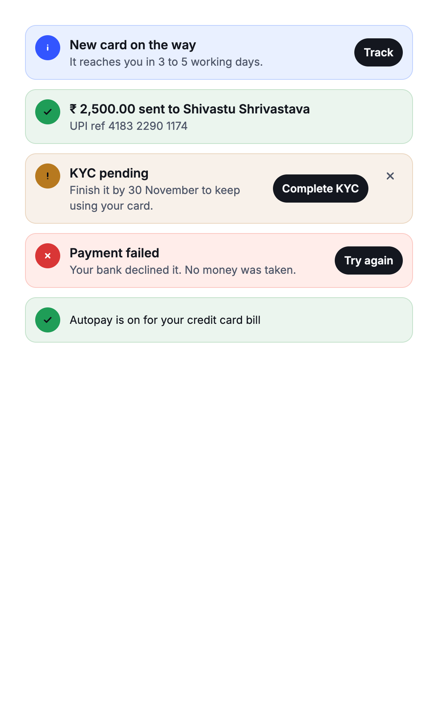

<div align="center">

# Moksha UI

**One design system for React and React Native.**<br />
The same component API and design tokens, with native rendering on each platform.


</div>

<p align="center"></p>


## Why Moksha UI

- **One API, two platforms.** `import { Button } from '@moksha-ui/core'` renders a real `<button>` with CSS on the web and `Pressable` with `StyleSheet` on iOS and Android. No `react-native-web`, no bundler config.
- **Every design value in one file.** Colors, type, spacing, radius, shadows, motion, glass and component sizes live in [`theme.ts`](packages/tokens/src/theme.ts). Change it and web and native update together.
- **Your brand in one line.** `createTheme({ brandColor })` generates a full color scale and both light and dark tokens, kept at WCAG AA contrast. Tests check this for 12 very different brand colors.
- **Premium by default.** Motion runs on real spring physics that feel the same on web and native, surfaces have depth, hairline edges and frosted glass, and showpieces like a 3D bank card and a rolling balance come built in.
- **Light, dark and glass.** Every component supports both color schemes, and surfaces and inputs have a frosted glass variant.
- **Built for fintech forms.** Phone, amount (Indian digit grouping), bank account (masked) and OTP / PIN fields that keep the caret in place while they format.
- **Accessible by default.** Labelled inputs, linked error messages, visible focus rings, and support for reduced motion and reduced transparency. Colored text, badges and tags are adjusted automatically until they pass WCAG AA.

## Contents

- [Quick start](#quick-start)
- [Theme builder](#theme-builder)
- [Components](#components): [Buttons](#buttons) · [Inputs](#inputs) · [AutoForm](#autoform) · [Surface and glass](#surface-and-glass) · [Overlays](#overlays) · [Bank card](#bank-card) · [Rolling amount](#rolling-amount) · [Primitives](#primitives) · [Motion](#motion)
- [Design tokens](#design-tokens)
- [How it works](#how-it-works)
- [Accessibility](#accessibility)
- [Development](#development)
- [Roadmap](#roadmap)

## Quick start

```sh
npm install @moksha-ui/core
```

> The packages are not on npm yet. Until the first release, clone this repo and run `npm install && npm run build`.

**Web** (Vite, Next.js, any React 19 app). Load the Inter font, then wrap your app:

```tsx
import { Button, ThemeProvider } from '@moksha-ui/core';

export function App() {
  return (
    <ThemeProvider colorScheme="light">
      <Button onPress={() => alert('Paid')}>Pay now</Button>
    </ThemeProvider>
  );
}
```

There are no CSS files to import: `ThemeProvider` adds the styles once, works with server rendering, and the web components are marked `'use client'` for the Next.js App Router.

**React Native** (Expo or bare). Load the Inter weights with `expo-font`, then pass their names so text uses them (without them the system font is used):

```tsx
import { BlurView } from 'expo-blur';
import { ThemeProvider, foundations } from '@moksha-ui/core';

<ThemeProvider colorScheme={scheme} fonts={foundations.typography.fontFamily.native} blurView={BlurView}>
  <App />
</ThemeProvider>;
```

`blurView` is optional. It powers glass surfaces; without it they fall back to a solid surface, so Moksha UI never forces a native module on your app.

## Theme builder

Give one brand color and `createTheme` builds the rest: a 10-step scale generated in OKLCH (so the steps look even), plus the primary tokens for light and dark. Each step is picked to pass WCAG AA, and your exact color is used wherever it is readable.


```tsx
import { ThemeProvider, createTheme } from '@moksha-ui/core';

const theme = createTheme({
  brandColor: '#0E9F7A',
  colors: { light: { success: '#16803C' } }, // any semantic color, per scheme
  foundations: {
    radius: { md: 12 },
    typography: { fontFamily: { web: 'Manrope, sans-serif' } },
  },
  components: { button: { sizes: { md: { height: 48 } } } },
});

<ThemeProvider theme={theme} colorScheme="dark">
  <App />
</ThemeProvider>;
```

- Every option is optional: anything you leave out keeps the default.
- Overriding `primary` on its own recomputes `textOnPrimary`, so text stays readable.
- A nested `ThemeProvider` keeps its parent's theme, so `<ThemeProvider colorScheme="dark">` inside a branded section only switches the scheme.
- Several themes can share one page: each theme's CSS variables are scoped to its own provider.
- Try it live in Storybook: **Foundations → Theme builder**.

## Components

### Buttons


```tsx
<Button onPress={pay}>Pay now</Button>
<Button variant="secondary" size="lg">View statement</Button>
<Button loading>Paying</Button>
<Button fullWidth disabled={!valid}>Continue</Button>
```

Buttons are pills. The primary one is lit from the top with a thin highlight and a soft glow in the brand color; secondary is a soft tint. Hover fades in a pressed layer instead of swapping the gradient, so nothing flickers, and every button shrinks slightly on press. A loading button keeps its color, shows a spinner and is announced as busy; only a disabled button fades.

`IconButton` is the round version for a single icon, in `solid`, `soft`, `glass` and `ghost`. It needs an `accessibilityLabel`, since an icon alone has no name:

```tsx
<IconButton icon={<EyeIcon />} accessibilityLabel="Hide balance" pressed={hidden} variant="ghost" />
```

<details>
<summary>Button props</summary>

| Prop | Type | Default |
| --- | --- | --- |
| `children` | `string` | |
| `onPress` | `() => void` | |
| `variant` | `'primary' \| 'secondary' \| 'ghost'` | `'primary'` |
| `size` | `'sm' \| 'md' \| 'lg'` | `'md'` |
| `loading` | `boolean`: spinner, busy state, blocks presses | |
| `disabled` | `boolean` | |
| `fullWidth` | `boolean` | |
| `accessibilityLabel` | `string` | the label |
| `testID` | `string`: `data-testid` on web, `testID` on native; the spinner gets `${testID}-spinner` | |

</details>

### Inputs

`TextField` is the base. Every other input is a `TextField` with a formatter, so they all share labels, helper and error text, prefixes, variants (`outline`, `filled`, `glass`), sizes and keyboard handling.

Fields rest with a soft shadow and get a 4 px halo in the brand color on focus (red when there is an error), with a brand-colored caret. OTP cells show a blinking caret in the cell that takes the next digit.


```tsx
<TextField label="Full name" helperText="As on your PAN card" />
<PhoneField label="Mobile number" value={mobile} onChangeText={setMobile} />   // shows 98765 43210, returns "9876543210"
<AmountField label="Amount" value={amount} onChangeText={setAmount} />        // shows ₹ 12,34,567.89, returns "1234567.89"
<AccountNumberField label="Account number" />                                 // •••• •••• 9012 when not editing
<SearchField label="Search transactions" placeholder="Search" />              // hidden label, search icon, clear button
<OtpField label="Enter OTP" onComplete={verify} />                            // paste and SMS autofill work
<OtpField label="Card PIN" length={4} masked />
```

<table>
<tr>
<td width="44%"></td>
<td>

**A real form.** The re-enter field blocks pasting (`allowPaste={false}`), shows a mismatch error, and the button stays disabled until everything is valid.

```tsx
<AccountNumberField
  label="Re-enter account number"
  value={confirm}
  onChangeText={setConfirm}
  allowPaste={false}
  maskWhenBlurred={false}
  error={mismatch ? "Account numbers don't match" : undefined}
/>
```

- `onChangeText` always receives the **raw** value, while the field shows the formatted one.
- On the web the caret stays where you are typing, even when spaces or commas move.
- Build your own formatted field with `format` and `parse`:<br />`<TextField format={(v) => groupDigits(v, [4, 4, 4])} parse={digitsOnly} />`

</td>
</tr>
</table>

The formatters and validators are exported too: `formatAmount`, `parseAmount`, `formatPhone`, `formatAccountNumber`, `maskAccountNumber`, `isValidIndianMobile`, `isValidAccountNumber`, `digitsOnly`, `groupDigits`.

<details>
<summary>TextField props</summary>

| Prop | Type | Default |
| --- | --- | --- |
| `label` | `string` (required) | |
| `hideLabel` | `boolean`: keeps it for screen readers | |
| `value` / `defaultValue` / `onChangeText` | raw value, controlled or not | |
| `helperText` / `error` | `string` | |
| `variant` | `'outline' \| 'filled' \| 'glass'` | `'outline'` |
| `size` | `'md' \| 'lg'` | `'md'` |
| `prefix` / `suffix` | text or any element | |
| `inputMode` | `'text' \| 'numeric' \| 'decimal' \| 'tel' \| 'email' \| 'search' \| 'url'` | `'text'` |
| `autoComplete` | `'one-time-code'`, `'tel'`, `'email'`, … | |
| `format` / `parse` | raw value ↔ what the field shows | |
| `maxLength`, `secureTextEntry`, `clearable`, `allowPaste`, `required`, `disabled`, `readOnly` | | |
| `testID` | on the input; the input box gets `${testID}-control` | |

</details>

### AutoForm

Pass a list of fields and get a complete form: the right input for each type, validation, error messages, focus handling and a submit button with a loading state. On web and React Native.

<table>
<tr>
<td width="44%"></td>
<td>

```tsx
import { AutoForm, defineFields } from '@moksha-ui/core';

const fields = defineFields([
  { name: 'name', type: 'text', label: 'Payee name', required: true },
  { name: 'mobile', type: 'phone', label: 'Mobile number', required: true },
  { name: 'account', type: 'account', label: 'Account number', required: true },
  { name: 'confirm', type: 'account', label: 'Confirm account number',
    required: true, matches: 'account', allowPaste: false },
  { name: 'amount', type: 'amount', label: 'Amount',
    required: true, min: 1, max: 200000 },
]);

<AutoForm
  fields={fields}
  submitLabel="Add payee"
  onSubmit={async (values) => {
    // values.mobile, values.amount… typed from the names
    const result = await api.addPayee(values);
    if (!result.ok) return { account: result.message };
  }}
/>
```

</td>
</tr>
</table>

- **Types:** `text`, `email`, `password`, `phone`, `amount`, `account`, `otp`. Every other prop of the matching component works too (`helperText`, `maskWhenBlurred`, `format`, `variant`…).
- **Built-in checks:** required, Indian mobile numbers, amount `min` and `max`, account numbers (9 to 18 digits), OTP length and email. `matches` compares two fields, and `validate(value, values)` adds your own rule.
- **Errors appear after a field loses focus or on submit**, never while someone is still typing, and they clear as soon as the value is fixed. Submitting with errors focuses the first one.
- **Server errors:** return `{ fieldName: message }` from `onSubmit` to show them on those fields.
- **Enter, or the keyboard's return key,** moves to the next field; on the last field it submits. A form cannot be submitted twice while `onSubmit` is running.
- The field list is plain data, so it can come from your server as JSON. `validateForm(fields, values)` runs the same checks anywhere, including on the server.
- Every field also takes a `ref` with `focus()`.

### Surface and glass


```tsx
<Surface variant="glass" blur="lg" padding="xl" radius="xl">
  <Balance />
</Surface>
```

- **Web:** `backdrop-filter` with the theme's blur and saturation. Browsers without it, and users who turn on "reduce transparency", get a solid surface.
- **React Native:** uses the `blurView` you pass to `ThemeProvider` (for example `BlurView` from expo-blur), with a solid fallback.

<details>
<summary>Surface props</summary>

| Prop | Type | Default |
| --- | --- | --- |
| `variant` | `'solid' \| 'raised' \| 'glass'` | `'solid'` |
| `padding` | spacing token, `'xs'` … `'3xl'` | `'lg'` |
| `radius` | radius token, `'sm'` … `'full'` | `'lg'` |
| `blur` | glass only: `'sm' \| 'md' \| 'lg'` | `'md'` |
| `shadow` | `'none' \| 'sm' \| 'md' \| 'lg'` | `md` for raised and glass, none for solid |
| `testID` | `string` | |

</details>

### Overlays

<table>
<tr>
<td width="36%"></td>
<td></td>
</tr>
</table>

```tsx
<Dialog
  open={open}
  onClose={() => setOpen(false)}
  title="Block your card?"
  actions={
    <>
      <Button variant="ghost" onPress={() => setOpen(false)}>Cancel</Button>
      <Button onPress={blockCard}>Block card</Button>
    </>
  }
>
  Payments and withdrawals stop right away.
</Dialog>

<BottomSheet open={open} onClose={close} title="Pay from">…</BottomSheet>

<Banner tone="warning" title="KYC pending" action={{ label: 'Complete KYC', onPress: openKyc }}>
  Finish it by 30 November to keep using your card.
</Banner>

<PromoBanner
  eyebrow="Travel card"
  title="Pay abroad with zero forex markup"
  description="Use it in 180+ countries. Free ATM withdrawals."
  action={{ label: 'Get the card', onPress: openOffer }}
/>

// Once, near the root:
<SnackbarProvider><App /></SnackbarProvider>
// Anywhere below:
const snackbar = useSnackbar();
snackbar.show({ message: 'Payee deleted', action: { label: 'Undo', onPress: restore } });
```

- **Dialog** is centered on larger screens and becomes a bottom sheet on phones (`presentation="auto"`). On the web it uses the native `<dialog>` element, so focus stays inside, Escape closes it, the page behind can't be reached, and focus goes back to the button that opened it. On React Native it uses `Modal`, and Android back closes it. `dismissible={false}` keeps it open until an action is chosen.
- **BottomSheet** always slides up from the bottom, with a handle.
- **Snackbar** shows one message at a time and queues the rest. It hides after the theme's `snackbar.duration`, and on the web stays while the pointer is over it or it has keyboard focus. Screen readers announce every message.
- **Banner** has four tones (info, success, warning, danger), each a soft tint of its color with a round icon. The action sits on the right, and moves under the text on narrow screens. Text passes WCAG AA on every tone, in every theme `createTheme` makes. Only `danger` interrupts a screen reader; the others wait their turn.
- **PromoBanner** is for offers on a home screen: the brand gradient, an eyebrow, a title, one call to action, and a glass card drawn in the corner (pass `art` to use your own). The same gradient is drawn on React Native.


### Bank card


```tsx
<BankCard last4="4821" holder="Shivastu Shrivastava" expiry="08/29" finish="midnight" />
<BankCard {...card} flipped />  {/* the back: signature strip and CVV */}
<BankCard {...card} frozen />   {/* frosted, says "Frozen" */}
```

- Tilts toward the pointer (web) or finger (React Native) with a spring, and catches the light: a glare follows the pointer and a holographic band shifts across the card.
- Finishes: `brand` (follows your `createTheme` brand color), `midnight` and `metal`, with a gold chip, contactless mark and engraved pattern.
- `flipped` turns it over with a spring; `frozen` frosts it. With reduced motion it stays flat and flips at once.
- A card is a physical object, so it looks the same in light and dark mode. Screen readers hear one line: "Moksha card ending in 4821, Shivastu Shrivastava, expires 08/29".
- Bring your own network mark through `network`; real network logos are trademarks.

### Rolling amount


```tsx
<RollingAmount value={balance} size="xl" hidden={hideBalance} />
```

- Each digit is a reel that rolls to its new value with the `smooth` spring, lower places first, so a change ripples across the number like a mechanical counter. Digits roll up from 0 when the amount first appears.
- A digit keeps its reel as the number grows or shrinks: the units reel stays the units reel from 9,999 to 10,000.
- `hidden` blurs the amount on the web and shows bullets on React Native, for a "hide balance" toggle. Screen readers hear "Balance hidden" instead of the digits.
- Screen readers hear the amount once ("₹24,580.00"), never digit by digit. Indian grouping by default; `currency` and `decimals` change the rest.

### Primitives


```tsx
<Text variant="heading" as="h2">Good evening, Shivastu</Text>
<Text variant="label" tone="success">Paid</Text>

<Stack direction="row" gap="md" align="center">
  <Avatar name="Shivastu Shrivastava" status="online" />
  <Tag tone="warning" dot>KYC pending</Tag>
  <Badge count={3} label="3 unread notifications" />
</Stack>

<Chip label="Food" selected={food} onSelectedChange={setFood} />
<ProgressBar value={42} label="Monthly budget used" />
<ProgressRing value={72} label="Budget used">72%</ProgressRing>
<Skeleton lines={2} />
```

- **Text** uses the theme's type styles; tones are adjusted to pass AA, so green and amber text stay readable. **Stack** lays children out with theme spacing; **Divider** can carry a label like "or continue with".
- **Badge** pops each time its count changes and has a hairline and a glossy top edge. **Tag** is a bordered status pill; **Chip** is a bordered filter that springs a check mark in when selected.
- **Avatar** shows a photo, or initials on a gradient picked from the name, so the same person always gets the same colors. **AvatarGroup** overlaps them with clean rings and reads the names once.
- **ProgressBar** springs its gradient fill to the value, or sweeps when the amount of work is unknown. **ProgressRing** is a circular gauge, drawn without SVG on React Native.
- **Spinner** and **Skeleton** cover loading; the skeleton shimmer stops with reduced motion. **Link** fades its underline in on hover and marks external links for screen readers.

### Motion

Motion is built in. Every component already moves: buttons press down, fields shake when an error appears, OTP digits pop in. To animate your own content, use `Motion` and `Stagger`:

```tsx
import { Motion, Stagger } from '@moksha-ui/core';

<Motion preset="fadeUp">
  <BalanceCard />
</Motion>

<Stagger>
  {payments.map((payment) => (
    <PaymentRow key={payment.id} {...payment} />
  ))}
</Stagger>
```

- Presets: `fade`, `fadeUp`, `fadeDown`, `scaleIn`, `slideUp`. Durations, easings, distances and the stagger interval are theme tokens, so `createTheme` can change them.
- **Springs** (`snappy`, `smooth`, `bouncy`) are real physics: on the web they become CSS `linear()` easings (`var(--ds-spring-smooth)`), and on React Native the same stiffness and damping go to `Animated.spring`, so both platforms move the same way.
- **Web:** CSS keyframes, with no JavaScript animation loop. **React Native:** `Animated` on the native driver, using the same easing curves as the web.
- With reduced motion turned on (`prefers-reduced-motion` on the web, Reduce Motion on iOS and Android), movement becomes a plain fade or is skipped.

<details>
<summary>Motion props</summary>

| Prop | Type | Default |
| --- | --- | --- |
| `preset` | `'fade' \| 'fadeUp' \| 'fadeDown' \| 'scaleIn' \| 'slideUp'` | `'fadeUp'` |
| `delay` | ms | `0` |
| `duration` | `'fast' \| 'normal' \| 'slow'` | `'normal'` |
| `easing` | easing token | `'enter'` |
| `interval` | `Stagger` only: ms between items | theme `motion.stagger` |
| `testID` | `string` | |

`useReducedMotion()` is exported too, for your own animations.

</details>

## Design tokens

Every design value lives in one file, [`packages/tokens/src/theme.ts`](packages/tokens/src/theme.ts). Raw hex values exist only in its palette: semantic colors, glass, overlays and shadows are all built from palette tokens, and tests fail if a raw color appears anywhere else.


<table>
<tr>
<td></td>
<td></td>
</tr>
</table>

| Export | What it holds |
| --- | --- |
| `palette` | Raw scales: `brand` (Cobalt `#3355FF`), `slate`, `green`, `amber`, `red`. Components never use these directly. |
| `themes.light` / `themes.dark` | Semantic `colors` and `shadows` for each color scheme |
| `foundations` | `typography` (families, weights, sizes, line heights, letter spacing, `textStyles`), `space`, `radius`, `borderWidth`, `opacity`, `focusRing`, `motion`, `glass`, `zIndex`, `breakpoints` |
| `components` | Component decisions built from the above: button, field and OTP sizes |
| `createTheme(options)` | Your own theme: a brand color plus any overrides |
| `getTheme(scheme)` | The default theme resolved for `'light'` or `'dark'` |

Semantic colors are named by role and grouped by prefix, so autocomplete shows related ones together:

| Group | Tokens |
| --- | --- |
| Backgrounds | `background`, `surface`, `surfaceRaised`, `surfaceInverse`, `glassSurface`, `glassBorder` |
| Text | `text`, `textMuted`, `textOnPrimary`, `textInverse` |
| Brand | `primary`, `primaryPressed`, `primarySubtle` |
| Status | `success`, `warning`, `danger` |
| Other | `border`, `focusRing`, `overlay` |

In components, `useTheme()` returns the resolved theme on both platforms:

```tsx
const { colors, space, radius, shadows, typography } = useTheme();
```

On the web, every token is also a CSS variable inside `ThemeProvider`, so your own CSS can use them:

```css
.card {
  background: var(--ds-color-surface-raised);
  padding: var(--ds-space-lg);
  border-radius: var(--ds-radius-lg);
  box-shadow: var(--ds-shadow-md);
  transition: transform var(--ds-duration-fast) var(--ds-easing-standard);
}
```

## How it works


```
packages/ui/src/
├─ index.ts               web entry    → *.web.tsx
├─ index.native.ts        native entry → *.native.tsx
├─ TextField/
│  ├─ TextField.shared.ts  props, shared by both
│  ├─ TextField.web.tsx    <input> + CSS classes
│  ├─ TextField.css.ts     web styles, reading theme CSS variables
│  └─ TextField.native.tsx TextInput + StyleSheet
└─ inputs/fields.shared.tsx  Phone, Amount, AccountNumber, Search: written once,
                             given each platform's TextField
```

- `package.json` exports the native entry under the `react-native` condition, which Metro uses; every other bundler gets the web entry.
- Each entry imports its platform files explicitly, so every import in the build is fully specified ESM that loads in Metro, Vite, webpack and plain Node.
- On the web, `ThemeProvider` renders one deduplicated React 19 `<style>` for the components, and one per theme with that theme's CSS variables.

## Accessibility

- Text and key color pairs pass **WCAG AA** in both schemes, for the default theme and for every theme `createTheme` generates. This is checked in tests.
- Colors that would fail are fixed at the source: `ensureContrast` nudges a color's lightness, keeping its hue, until it passes. Colored text tones, badge fills, tag text and avatar gradients all go through it.
- Inputs use their label as the accessible name. Helper and error text are linked (`aria-describedby` on web, `accessibilityHint` on native), and on the web errors also set `aria-invalid`.
- Buttons announce busy and disabled states; keyboard focus shows a visible ring.
- Motion respects reduced motion on every platform (`prefers-reduced-motion` on the web, Reduce Motion on iOS and Android), and glass respects `prefers-reduced-transparency`.

## Development

```sh
npm install
npm run build        # tokens, then ui
npm test             # token contrast + web (Vitest) + native (Jest)
npm run typecheck
npm run storybook    # web docs on http://localhost:6007
npm run native       # Expo dev server; open it in Expo Go
```

| Folder | What it is |
| --- | --- |
| [`packages/tokens`](packages/tokens) | `@moksha-ui/tokens`: the theme file, color engine and contrast tests |
| [`packages/ui`](packages/ui) | `@moksha-ui/core`: components, `ThemeProvider` and `createTheme` |
| [`apps/docs`](apps/docs) | Storybook for the web components, with a light/dark switch and the theme builder |
| [`apps/native-demo`](apps/native-demo) | Expo app using the same components on iOS and Android |

## Roadmap

- [x] One theme file, light and dark, `createTheme` with brand colors and overrides
- [x] Button, Surface (with glass)
- [x] TextField, PhoneField, AmountField, AccountNumberField, SearchField, OtpField
- [x] Storybook docs, theme builder and Expo demo
- [x] Motion: `Motion`, `Stagger` and built-in component animations
- [x] AutoForm: build a whole form from a list of fields, with validation
- [x] Dialog (becomes a bottom sheet on phones), BottomSheet, Snackbar, Banner, PromoBanner
- [x] Spring motion tokens and the 3D BankCard
- [x] RollingAmount (balance with rolling digits)
- [ ] Blocks: slide to pay, payment success, phone + OTP login, transactions feed
- [ ] Showcase site with a live gallery, and one-command install (shadcn registry, llms.txt)
- [ ] Hosted Storybook and automated npm releases

### Next 50 components

Every one ships for web and React Native, uses only theme tokens, and is tested on both platforms.

- **Primitives:** [x] Text · [x] Stack · [x] Divider · [x] Spinner · [x] Skeleton · [x] Badge · [x] Tag · [x] Chip · [x] Avatar · [x] AvatarGroup · [x] ProgressBar · [x] ProgressRing · [x] Link
- **Selection and input:** [x] Switch · [x] Checkbox · [x] RadioGroup · [x] SegmentedControl · [ ] Slider · [ ] NumberStepper · [ ] Select · [ ] DatePicker · [ ] TextArea · [ ] PinPad · [ ] SlideToConfirm · [ ] FileUpload · [ ] CopyField
- **Navigation:** [ ] Tabs · [ ] AppBar · [ ] TabBar · [ ] Sidebar · [ ] Breadcrumbs · [ ] Pagination · [ ] StepIndicator · [ ] Drawer
- **Lists and display:** [ ] ListItem · [ ] ListGroup · [ ] Accordion · [ ] StatCard · [ ] DetailRow · [ ] Timeline · [ ] EmptyState · [ ] TransactionRow · [ ] Receipt · [ ] Sparkline · [ ] CardStack
- **Feedback and overlays:** [ ] Tooltip · [ ] Popover · [ ] Menu · [ ] SuccessCheck · [ ] ResendTimer

## License

[MIT](LICENSE) © Shivastu Shrivastava
