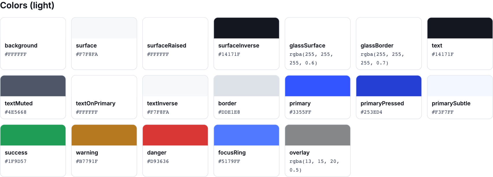

# @moksha-ui/tokens

Design tokens for [Moksha UI](https://github.com/shivastuu/moksha-ui): colors, typography, spacing, radius, shadows, spring motion and glass, for web and React Native. Plain TypeScript with no dependencies.

`@moksha-ui/core` already includes these tokens. Install this package on its own only if you want the tokens without the components.

```sh
npm install @moksha-ui/tokens
```

```ts
import { createTheme, getTheme } from '@moksha-ui/tokens';

const theme = createTheme({ brandColor: '#0E7C66' }); // light and dark tokens, kept at WCAG AA
const { colors } = getTheme('dark');
```



Full token reference: [Design tokens](https://github.com/shivastuu/moksha-ui#design-tokens).

MIT © Shivastu Shrivastava
