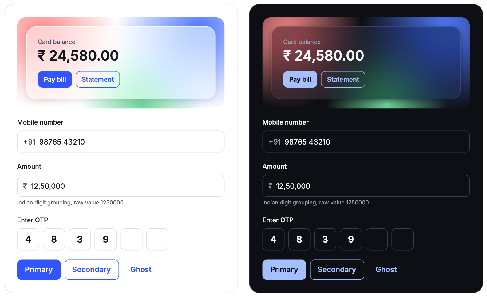

# Moksha UI

**One design system for React and React Native.** The same component API and design tokens, with native rendering on each platform: a real `<button>` with CSS on the web, `Pressable` on iOS and Android.



- Your brand in one line: `createTheme({ brandColor })` builds light and dark tokens kept at WCAG AA contrast.
- Spring motion that feels the same on web and native, hairline edges, frosted glass.
- Fintech-ready inputs: phone, amount (Indian digit grouping), masked account number, OTP, and `AutoForm`.
- Accessible by default: labelled inputs, linked errors, focus rings, reduced motion and reduced transparency.

## Install

```sh
npm install @moksha-ui/core
```

Needs React 19. On native, React Native 0.87 or newer with the New Architecture: gradients use `backgroundImage`, which drops its `experimental_` prefix in 0.87, and shadows use `boxShadow`.

## Web

Load the Inter font, then wrap your app. There are no CSS files to import, and it works with server rendering and the Next.js App Router.

```tsx
import { Button, ThemeProvider } from '@moksha-ui/core';

export function App() {
  return (
    <ThemeProvider colorScheme="light">
      <Button onPress={() => alert('Paid')}>Pay now</Button>
    </ThemeProvider>
  );
}
```

## React Native

Load the Inter weights with `expo-font`, then pass their names. `blurView` is optional and powers glass surfaces.

```tsx
import { BlurView } from 'expo-blur';
import { ThemeProvider, foundations } from '@moksha-ui/core';

<ThemeProvider colorScheme={scheme} fonts={foundations.typography.fontFamily.native} blurView={BlurView}>
  <App />
</ThemeProvider>;
```

## Docs

Every component, the theme builder and the design tokens are documented in the [GitHub repo](https://github.com/shivastuu/moksha-ui#readme).

MIT © Shivastu Shrivastava
